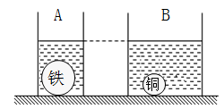

# Physics - 题目 2102

**ID**: 66184004d65248c584f58e93bdfa0517
**年级**: Grade 9
**难度**: Medium-Hard
**题型**: Multiple-choice

## 题目
两薄壁圆柱形容器A、B底面积不同（S_{A}<S_{B}），容器内分别盛有两种不同液体。​​​​​​​‌现将质量相同的实心铁球和铜球分别浸没在液体中（ρ_{铁}<ρ_{铜}），两液面相平，如图所示，此时液体对容器底部的压力相等。将两球从液体中取出后，关于容器底部受到的液体压力F、液体压强p的大小关系，下列判断中正确的是（      ）

## 解答

1. 设A容器中液体的密度为ρ_{A}，B容器中液体的密度为ρ_{B}，球拿出前两液面的高度为h，因为两个球拿出前，两容器中液体对容器底的压力相等，即
2. $ρ{{}_{{\rm{A}}}}ghS{{}_{{\rm{A}}}}=ρ{{}_{{\rm{B}}}}ghS{{}_{{\rm{B}}}}$
3. 又因为S_{A}<S_{B}，所以ρ_{A}>ρ_{B}，将两个球拿出后，A容器中液体对容器底的压力为
4. $F{{}_{{\rm{A}}}}=ρ{{}_{{\rm{A}}}}g\left ({h-\frac {V{{}_{铁}}}{S{{}_{{\rm{A}}}}}}\right )S{{}_{{\rm{A}}}}=ρ{{}_{{\rm{A}}}}ghS{{}_{{\rm{A}}}}-ρ{{}_{{\rm{A}}}}gV{{}_{铁}}$
5. 将两个球拿出后，B容器中液体对容器底的压力为
6. $F{{}_{{\rm{B}}}}=ρ{{}_{{\rm{B}}}}g\left ({h-\frac {V{{}_{铜}}}{S{{}_{{\rm{B}}}}}}\right )S{{}_{{\rm{B}}}}=ρ{{}_{{\rm{B}}}}ghS{{}_{{\rm{B}}}}-ρ{{}_{{\rm{B}}}}gV{{}_{铜}}$
7. 因为铜的密度大于铁的密度，则质量相等的铜球的体积小于铁球的体积，上面两式相减可得
8. $F{{}_{{\rm{B}}}}-F{{}_{{\rm{A}}}}=ρ{{}_{{\rm{A}}}}gV{{}_{铁}}-ρ{{}_{{\rm{B}}}}gV{{}_{铜}}>0$
9. 所以A容器底部的压力小于B容器底部的压力；
10. 两球拿出后，A容器中液体对容器底的压强为
11. $p{{}_{{\rm{A}}}}=ρ{{}_{{\rm{A}}}}g\left ({h-\frac {V{{}_{铁}}}{S{{}_{{\rm{A}}}}}}\right )$
12. B容器中液体对容器底的压强为
13. $p{{}_{{\rm{B}}}}=ρ{{}_{{\rm{B}}}}g\left ({h-\frac {V{{}_{铜}}}{S{{}_{{\rm{B}}}}}}\right )$
14. 结合上面分析，不能确定p_{A}和p_{B}的关系。
15. 故选A。

## 知识点

**中文**:
  - 压力的概念及其计算
  - 液体压强计算公式的应用

**English**:
  - Concept and Calculation of Pressure Force
  - Application of Liquid Pressure Formula

---
