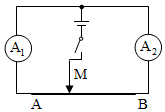

# Physics - 题目 1515

**ID**: 68ac580a41f54a7c9a14f8c98b30587b
**年级**: Grade 9
**难度**: Medium-Hard
**题型**: Multiple-choice

## 题目
如图所示电路，电源电压不变，AB为铅笔芯，开关闭合后，当滑片M在中点时，电路的总功率为P；​​​​​​​‌滑片M向左滑动一段距离时电路的总功率为 $\frac {4}{3}$P，此时电流表A_{1}和A_{2}的示数之比为（      ）

## 解答

1. 由电路图可知，铅笔芯电阻AM部分和BM部分并联，电流表A_{1}测通过AM部分电阻的电流，电流表A_{2}测通过BM部分电阻的电流；若铅笔芯AB的总电阻为2R，电源的电压为U，当滑片M在中点时，电路的总功率为P，因并联电路中各支路两端的电压相等，且干路电流等于各支路电流之和，所以，干路电流
2. $I=\frac {U}{R}+\frac {U}{R}=\frac {2U}{R}$
3. 由 $P＝UI$ 可得，干路电流
4. $I=\frac {P}{U}$
5. 则
6. $\frac {P}{U}=\frac {2U}{R}$ ①
7. 设滑片M向左滑动一段距离时，左右两侧电阻的改变量为ΔR，此时干路电流
8. $I^{′}=\frac {U}{R-ΔR}+\frac {U}{R+ΔR}=\frac {2UR}{R{^{2}}-ΔR{^{2}}}=\frac {\frac {4}{3}P}{U}$ ②
9. 由①②可得
10. $R=2ΔR$
11. 此时电流表A_{1}和A_{2}的示数之比
12. $\frac {I{{}_{1}}}{I{{}_{2}}}=\frac {\frac {U}{R-ΔR}}{\frac {U}{R+ΔR}}=\frac {R+ΔR}{R-ΔR}=\frac {R+\frac {R}{2}}{R-\frac {R}{2}}=\frac {3}{1}$
13. 故选C。

## 知识点

**中文**:
  - 并联电路的电流规律
  - 欧姆定律的应用
  - 电功率的计算及应用

**English**:
  - Current Law in Parallel Circuits
  - Applications of Ohm's Law
  - Calculation and Application of Electric Power

---
