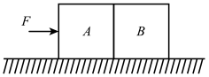

# Physics - 题目 2149

**ID**: 6be2232ffdad476fa69a9a5281ccb2ab
**年级**: Grade 9
**难度**: Medium-Hard
**题型**: Multiple-choice

## 题目
如图所示，小明用大小恒定的力F推动木块A、B一起沿水平桌面向右做匀速直线运动。​​​​​​​‌下列说法正确的是（      ）

## 解答

1. 小明用大小恒定的力F推动木块A、B一起沿水平桌面向右做匀速直线运动，将A、B作为一个整体，A、B在水平方向上受到的摩擦力与推力F是一对平衡力，即小明对木块A的推力F等干A、B受到的摩擦力之和。
2. A．小明对木块A的推力F和桌面对木块A的摩擦力大小不相等，所以不是一对平衡力，故A错误；
3. B．木块A对木块B的推力和桌面对木块B的摩擦力大小相等、方向相反、作用在同一个物体上，作用在同一条直线上，所以是一对平衡力，故B正确；
4. C．小明对木块A的推力F和木块B对木块A推力是作用在同一物体上的两个力，且大小不相等，所以不是一对相互作用力，故C错误；
5. D．地面对木块A的摩擦力和木块B对地面的摩擦力，此摩擦力不是相互作用的两个物体产生的摩擦力，所以不是一对相互作用力，故D错误。
6. 故选B。

## 知识点

**中文**:
  - 平衡力与相互作用力的区别

**English**:
  - Difference between Equilibrium Forces and Interaction Forces

---
