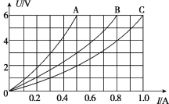

# Physics - 题目 1951

**ID**: 6d7621043b9d4be18d836cb2567dfae2
**年级**: Grade 9
**难度**: Medium-Hard
**题型**: Multiple-choice

## 题目
现有额定电压均为6V的A、B、C三盏小灯泡，它们的U—I关系图像如图所示。​​​​​​​‌下列说法中正确的是（      ）

## 解答

1. A．将三盏灯串联在电压为12V的电路中，因为串联电路电流处处相等，电源电压等于各用电器两端电压之和，由图像可以得出此时电路中的电流在0.5A到0.6A之间，此时C灯的电压最低，又因灯泡的亮度取决于灯泡的实际功率，由P=UI可知，此时C灯实际电功率最低，亮度最暗，故A错误；
2. B．由图可知，A灯正常发光时，此时A灯的电压为6V，电流0.5A，由串联电路电路处处相等可知C灯的电压为2V，故此时C灯的功率
3. P=UI=2V×0.5A=1W
4. 故B正确；
5. C．由A选项可知，将三盏灯串联在电压为12V的电路中时，此时电路中的电流就已经大于0.5A，已经超过A灯的额定电流，串联在18V的电路中电流只会更大，故不可能均安全工作，故C错误；
6. D．将三盏灯并联在电压为6V的电路中，由图像可知，此时电路中的总电流
7. I_{总}=I_{1}+I_{2}+I_{3}=0.5A+0.8A+1.0A=2.3A
8. 此时电路的总功率
9. P_{总}=U_{总}I_{总}=6V×2.3A=13.8W
10. 故D错误。
11. 故选B。

## 知识点

**中文**:
  - 实际电压与实际功率
  - 电阻的伏安特性曲线
  - 电功率的计算及应用

**English**:
  - Actual Voltage and Actual Power
  - I-V Characteristic Curve of Resistance
  - Calculation and Application of Electric Power

---
