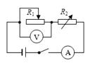

# Physics - 题目 780

**ID**: 6e9ec30c3f7846e4b8aa088cd9f08723
**年级**: Grade 9
**难度**: Medium-Hard
**题型**: Multiple-choice

## 题目
小明利用图的电路探究“导体中电流跟电阻的关系”。​​​​​​​‌电源电压恒定不变，多次改变电阻箱R_{2}的阻值，通过调节滑动变阻器接入电路的电阻R_{1}，正确完成实验，记录各次实验中电压表示数U和电流表示数 $I$ .则下列反映这四个量之间的变化关系图象中，一定不正确的是（      ）

## 解答

1. 由图知道，R_{1}、R_{2}与电流表串联在电路中，电压表测R_{1}两端电压，由控制变量法知道，探究“导体中电流跟电阻的关系”时应控制R_{2}两端电压保持不变，
2. A．图像中，电路中电流与R_{1}成反比，调节滑片后R_{1}两端电压（即电压表示数）也保持不变，由U_{1}=I R_{1}知道，I与R_{1}成反比，故A正确，不符合题意；
3. B．图像中，R_{1}两端电压不随R_{1}的变化而变化。实验中要控制R_{2}两端电压保持不变，电源电压恒定不变，由串联电路电压特点知道，应控制R_{1}两端电压不变，当改变R_{2}的阻值后，要保证R_{1}两端电压不变，由串联电路的分压原理知道，需要改变R_{1}连入电路的阻值，故B正确，不符合题意；
4. C．图像为过原点的直线，即R_{1}与R_{2}成正比。由于串联电路中电流处处相等，故I_{1}=I_{2}，由欧姆定律知道，
5. $\frac {U{{}_{1}}}{R{{}_{1}}}{\rm{=}}\frac {U{{}_{2}}}{R{{}_{2}}}$ ，
6. 实验中要控制R_{2}两端电压保持不变，也要控制R_{1}两端电压不变，即
7. $\frac {U{{}_{1}}}{U{{}_{2}}}{\rm{=}}\frac {R{{}_{1}}}{R{{}_{2}}}{\rm{=}}定值$ ，
8. 故C正确，不符合题意；
9. D．图像中，随电路中电流增大，R_{2}阻值变小。电源电压恒定不变，而
10. $I=\frac {U}{R{{}_{1}}+R{{}_{2}}}$ ，
11. 电阻箱R_{2}的阻值变化时，滑动变阻器R_{1}的阻值也要发生变化，I与R_{2}不是一次函数关系，故D错误，符合题意。

## 知识点

**中文**:
  - 电路的动态分析

**English**:
  - Dynamic Circuit Analysis

---
