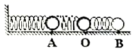

# Physics - 题目 167

**ID**: 747ad246b6c34ba599b753adac25b67c
**年级**: Grade 9
**难度**: Medium-Hard
**题型**: Multiple-choice

## 题目
如图所示，在光滑的水平台面上，一轻弹簧左端固定，右端连接一个金属小球， $O$ 点是弹簧保持原长时小球的位置。​​​​​​​‌压缩弹簧使小球至 $A$ 位置，然后释放小球，小球就在 $AB$ 间做往复运动（已知 $AO=OB$ ）。小球从 $A$ 位置运动到 $B$ 位置的过程中，下列判断正确的是（      ）

## 解答

1. 由题知， $O$ 点是弹簧保持原长时小球的位置，则 $AO$ 段弹簧处于压缩状态， $OB$ 段弹簧处于拉伸状态；小球从 $A$ 运动到 $O$ 的过程中，弹簧逐渐恢复原状，形变程度变小，弹性势能变小，小球所受弹力方向向右、速度不断增大，动能变大，此过程中弹性势能转化为动能；到达 $O$ 点时，弹簧恢复原长，弹性势能为零，小球所受弹力为零，此时速度最大，动能最大；小球从 $O$ 运动到 $B$ 的过程中，弹簧被拉长，形变程度变大，弹性势能变大，此时小球所受弹力方向向左、速度不断减小，动能变小，此过程中动能转化为弹性势能；则小球从 $A$ 位置运动到 $B$ 位置的过程中。
2. A．弹簧的弹性势能先变小后变大，故A错误；
3. B．小球的动能先增加后减少，故B错误；
4. C．弹簧的弹性势能先减少后增大，故C错误；
5. D．小球运动到 $O$ 点时速度最大，动能最大，故D正确。
6. 故选D。

## 知识点

**中文**:
  - 动能和势能的转化
  - 动能的变化问题
  - 弹性势能的变化问题

**English**:
  - Transformation between Kinetic and Potential Energy
  - Changes in Kinetic Energy
  - Changes in Elastic Potential Energy

---
