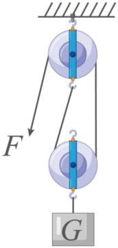

# Physics - 题目 2511

**ID**: 78d007ee56144cb484ecfed59eebc122
**年级**: Grade 9
**难度**: Medium-Hard
**题型**: Multiple-choice

## 题目
使用如图所示的滑轮组匀速提升重力不同的物体时，除了动滑轮的重力导致的额外功外，其他因素导致的额外功与总功之比为一定值。​​​​​​​‌已知动滑轮的重力为1.0N，绳子能够承受的最大拉力为50N。当匀速提升重为9.0N的物体时，滑轮组的机械效率为81%，则使用该滑轮组匀速提升物体时的机械效率的最大值为（      ）

## 解答

1. 当匀速提升重为9.0N的物体时，滑轮组的机械效率为81%，设物体匀速提升的高度为h，则拉力所做的有用功 $W{{}_{有}}＝Gh＝9.0{\rm{N}}\times h$ ，总功 $W{{}_{总}}{\rm{=}}\frac {W{{}_{有}}}{η}{\rm{=}}\frac {9{\rm{N}}\times h}{81{\rm{\%}}}=\frac {100}{9}{\rm{N}}\times h$ ，克服动滑轮重力所做的额外功， $W{{}_{额动}}＝G{{}_{动}}h＝1.0{\rm{N}}\times h$ ，除了动滑轮的重力导致的额外功外，其他因素导致的额外功 $W{{}_{额其它}}{\rm{=}}W{{}_{总}}-W{{}_{有}}-W{{}_{额动}}{\rm{=}}\frac {100}{9}{\rm{N}}\times h-9{\rm{N}}\times h-1{\rm{N}}\times h=\frac {10}{9}{\rm{N}}\times h$ ，其他因素导致的额外功与总功之比为 $\frac {W{{}_{额其它}}}{W{{}_{总}}}{\rm{=}}\frac {\frac {100}{9}{\rm{N}}\times h}{\frac {10}{9}{\rm{N}}\times h}=\frac {10}{1}$ ，由图可知，滑轮组绳子的有效股数n＝2，当使用该滑轮组匀速提升物体上升的高度为h时，绳子自由端移动的距离， $s＝nh＝2h$ ，由绳子能够承受的最大拉力为50N可知，拉力所做总功的最大值 $W{{}_{总大}}＝F{{}_{大}}s＝50{\rm{N}}\times 2h＝100{\rm{N}}\times h$ ，因除了动滑轮的重力导致的额外功外，其他因素导致的额外功与总功之比为一定值，所以，其他因素导致的额外功 $W{{}_{额其它大}}{\rm{=}}\frac {1}{10}W{{}_{总大}}{\rm{=}}\frac {1}{10}\times 100{\rm{N}}\times h=10{\rm{N}}\times h$ ，拉力所做有用功的最大值， $W{{}_{有大}}＝W{{}_{总大}}-W{{}_{额动}}-W{{}_{额其它大}}＝100{\rm{N}}\times h-1{\rm{N}}\times h-10{\rm{N}}\times h＝89{\rm{N}}\times h$ ，则使用该滑轮组匀速提升物体时的机械效率的最大值 $η{\rm{=}}\frac {W{{}_{有大}}}{W{{}_{总大}}}\times {\rm{1}}{\rm{0}}{\rm{0}}{\rm{\%}}{\rm{=}}\frac {89{\rm{N}}\times h}{100{\rm{N}}\times h}\times {\rm{1}}{\rm{0}}{\rm{0}}{\rm{\%}}=89{\rm{\%}}$ 。

## 知识点

**中文**:
  - 滑轮（组）的机械效率及其计算

**English**:
  - Mechanical Efficiency of Pulleys and Calculations

---
