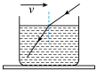

# Physics - 题目 485

**ID**: 7b2e3303e5b042dbbcf4afe43a0225ab
**年级**: Grade 9
**难度**: Medium-Hard
**题型**: Multiple-choice

## 题目
如图，向右匀速行驶的动车桌面上有杯水，一束光斜射到水面上，保持人射光方向不变。​​​​​​​‌动车减速时（      ）

## 解答

1. 动车减速，杯中水由于惯性还要保持原来的运动状态，所以杯中水面向前倾斜，入射光的方向不变，所以入射角变大，折射角随入射角变大而变大，故ABD错误；C正确。
2. 故选C。

## 知识点

**中文**:
  - 光的折射规律及其应用
  - 生活中的惯性现象

**English**:
  - Law of Refraction and Applications
  - Inertia Phenomena in Daily Life

---
