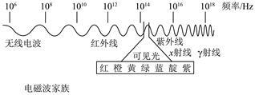

# Physics - 题目 1442

**ID**: 91c99585975e40d886d08aa5b70f1853
**年级**: Grade 9
**难度**: Medium-Hard
**题型**: Multiple-choice

## 题目
如图是电磁波家族，真空中各种电磁波的传播速度相同。​​​​​​​‌蓝牙通讯使用的甲频率是4×109Hz，消毒柜工作时使用的乙频率是1.4×1015Hz，根据所给信息可推测（      ）

## 解答

1. A．根据波速公式v=λf可知，波速一定，频率越高，波长越短，则甲的波长比乙的波长长，故A不符合题意；
2. B．蓝牙通讯使用的电磁波是无线电波，消毒柜使用的电磁波为紫外线，无线电波、紫外线都属于电磁波，故B符合题意；
3. C．消毒柜使用的电磁波为紫外线，是不可见光，故C不符合题意；
4. D．在真空中，电磁波的传播速度是相同的，故D不符合题意。
5. 故选B。

## 知识点

**中文**:
  - 波速与波长、频率的关系
  - 红外线的特点及应用
  - 紫外线的特点及应用
  - 电磁波的传播与应用

**English**:
  - Relationship: Speed, Wavelength, Frequency
  - Characteristics and Applications of Infrared
  - Characteristics and Applications of Ultraviolet
  - Propagation and Application of Electromagnetic Waves

---
