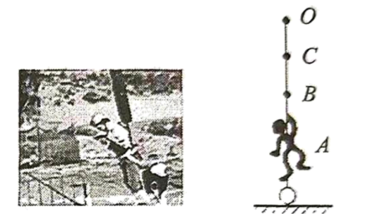

# Physics - 题目 2786

**ID**: 924ac41eb08045b5aeee7874106db8d6
**年级**: Grade 9
**难度**: Medium-Hard
**题型**: Multiple-choice

## 题目
如图所示为“反向蹦极”的示意图。​​​​​​​‌弹性轻绳的上端固定在O点，拉长后将下端固定在体验者的身上，体验者用扣环锁定在地面上，打开扣环，人从A点由静止释放，像火箭一样被“竖直发射”上升到最高位置C点，在B点时弹性轻绳的拉力与人的重力相等。上升过程中，人的动能E_{1}、重力势能E_{2}、机械能E_{3}和轻绳的弹性势能E_{4}随位置变化的关系图像中，可能正确的是（      ）

## 解答

1. A．人上升过程中，质量不变，速度先变大后减小，在B点达到最大，则人体的动能先变大后减小，B点最大，故A错误；
2. B．A点到C点，人上升过程中，质量不变，高度不断上升，人体的重力势能不断增大，而C点后人体将下落，则C点后高度降低，重力势能减小，故B错误；
3. C．在B点时弹性轻绳的拉力与人的重力相等，说明弹性轻绳在B点仍处于伸长状态，过B点后弹性绳仍对人体做功，人体的机械能仍然在增大，故C错误；
4. D．人体上升过程中，弹性绳的形变量不断减小，直到恢复原状，则轻绳的弹性势能不断减小，直到变为0，故D正确。

## 知识点

**中文**:
  - 动能的变化问题
  - 重力势能的变化问题
  - 弹性势能的变化问题
  - 机械能的变化问题

**English**:
  - Changes in Kinetic Energy
  - Changes in Gravitational Potential Energy
  - Changes in Elastic Potential Energy
  - Changes in Mechanical Energy

---
