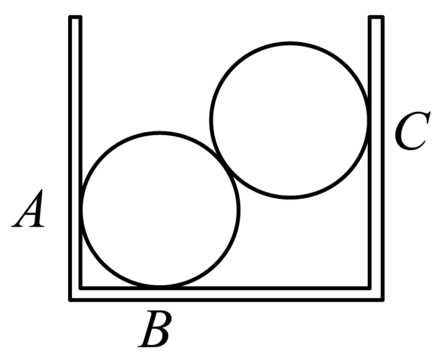

# Physics - 题目 1578

**ID**: 938429d1b0e443289805177556b305b4
**年级**: Grade 9
**难度**: Medium-Hard
**题型**: Multiple-choice

## 题目
如图所示，光滑的两个球体直径均为 $d$ ，置于一直径为 $D$ 的圆桶内，且有 $d<D<2d$ ，在桶与球接触的三点A、B、C，受到的压力大小分别为 $F{{}_{A}}$ 、 $F{{}_{B}}$ 、 $F{{}_{C}}$ ，如果桶的直径增大，但仍小于 $2d$ ，则 $F{{}_{A}}$ 、 $F{{}_{B}}$ 、 $F{{}_{C}}$ 的变化情况是（      ）​​​​​​​‌

## 解答

1. 上面球所受力如图所示：
2. 
3. 设下面球对上面球的弹力与竖直方向的夹角为 ${\rm{θ}}$ ，根据共点力平衡知， $F{{}_{C}}=mg{\rm{t}}{\rm{a}}{\rm{n}}{\rm{θ}}$ 。桶的直径 $D$ 稍增大一些，上面球将下落，则 ${\rm{θ}}$ 增大， ${\rm{t}}{\rm{a}}{\rm{n}}{\rm{θ}}$ 增大， $F{{}_{C}}$ 增大。对整体分析，受总重力和底端的支持力，两侧壁的两个弹力，底端的支持力等于总重力的大小等于 $F{{}_{B}}$ 的大小，所以 $F{{}_{B}}$ 不变；F_{A}与F_{C}相等，则FA也增大。故A符合题意，BCD不符合题意。
4. 故选A。

## 知识点

**中文**:
  - 力的合成与应用

**English**:
  - Composition of Forces and Applications

---
