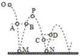

# Physics - 题目 157

**ID**: 986092a2e8024e2782c60ea1502d41df
**年级**: Grade 9
**难度**: Medium-Hard
**题型**: Multiple-choice

## 题目
将皮球从离地某一高度O点处水平抛出，球落地后又弹起。​​​​​​​‌它的部分运动轨迹如图所示．下列说法正确的是

## 解答

1. A．由图可知，每次小球反弹后到的最高点都比上一次的最高点要低，说明小球受到空气阻力，机械能逐渐变小，在A点的机械能大于在B点的机械能；机械能是物体动能与势能的总和，在A、B两点高度相同则重力势能相同，所以在A点的动能大于在B点的动能；故A错误。
2. B．从轨迹来看，小球既有水平方向的速度又有竖直方向的速度。小球在最高点时，竖直方向速度为零，但是仍然能往右运动，说明小球还具有水平方向速度，动能不为零；故B错误。
3. C．每次小球反弹后到的最高点都比上一次的最高点要低，说明小球受到空气阻力，机械能逐渐变小。在C点在在D点之前，故在D点的机械能小于在C点的机械能；故C错误。
4. D．弹性势能大小与弹性形变程度有关，黑色圆斑的大小能反应小球弹性形变程度，圆斑越大，形变越大。在M点与在N点小球的动能与重力势能都为零，又因为小球在M点机械能大于N点机械能，故小球在M点的弹性势能大于在N点的弹性势能，故在M点的圆斑要大于在N点的圆斑；故D正确。

## 知识点

**中文**:
  - 动能的影响因素
  - 重力势能的影响因素
  - 弹性势能

**English**:
  - Factors Affecting Kinetic Energy
  - Factors Affecting Gravitational Potential Energy
  - Elastic Potential Energy

---
