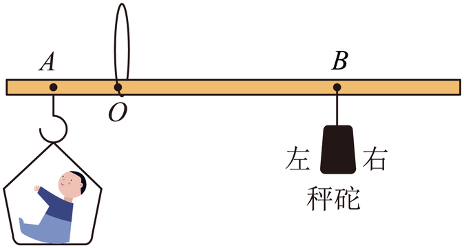

# Physics - 题目 2564

**ID**: a7ebdb8932a0406f974ad0afe4c6c21f
**年级**: Grade 9
**难度**: Medium-Hard
**题型**: Multiple-choice

## 题目
如图所示，在立夏时节，有的地方会给孩子称体重，希望孩子健康成长，俗称“立夏秤人”。​​​​​​​‌若小孩和篮子的总质量为16kg，调整秤砣的位置，使秤杆处于水平平衡状态（忽略绳重和杆重），此时 $OA=9{\rm{c}}{\rm{m}},OB=36{\rm{c}}{\rm{m}}$ 。下列说法不正确的是（      ）

## 解答

1. A．支点是杠杆发生作用时起支撑作用固定不动的一点，该杆秤的悬挂点O是称量时的支点，故A正确，不符合题意；
2. B．根据杠杆平衡条件 $F{{}_{1}}l{{}_{1}}=F{{}_{2}}l{{}_{2}}$ 可知， $G{{}_{人和篮子}}l{{}_{1}}=G{{}_{秤砣}}l{{}_{2}}$
3. 即 $m{{}_{人和篮子}}gl{{}_{1}}=m{{}_{秤砣}}gl{{}_{2}}$
4. 则 $16kg\times 9cm=m{{}_{秤砣}}\times 36cm$
5. 解得 $m{{}_{秤砣}}=4kg$ ，故B正确，不符合题意；
6. C．如果秤砣生锈了，其质量会变大。在测量时，根据杠杆平衡条件，在物体重力和动力臂不变的情况下，阻力变大，阻力臂会变小，测量结果会比实际值偏小，故C错误，符合题意；
7. D．因为孩子及秤钩和所坐篮子的总重力大于秤砣的重力，根据 $G=mg$ 可知，孩子及秤钩和所坐篮子的总质量大于秤砣的质量，若换称下一个体重较大的孩子，秤砣和篮子等都不变，则作用在杠杆A点的力变大，动力臂不变，作用在杠杆B点的力不变，根据杠杆平衡条件可知阻力臂会变大，所以调到水平平衡后秤砣的悬挂点应在B点右边，故D正确，不符合题意。

## 知识点

**中文**:
  - 杠杆及其五要素
  - 杠杆平衡条件的应用

**English**:
  - Levers and their Five Elements
  - Application of Lever Equilibrium Conditions

---
