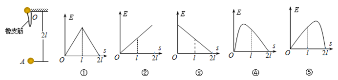

# Physics - 题目 2719

**ID**: aaba8aa1eecd4a3dbd7ab51230795e85
**年级**: Grade 9
**难度**: Medium-Hard
**题型**: Multiple-choice

## 题目
原长为l的橡皮筋一端固定在O点，另一端悬挂一个小钢球，将钢球从O点静止释放，钢球运动到A点后开始向上返回，O、A两点间距为2l。​​​​​​​‌下列图中，能反映钢球从O点运动到A点的过程中，小球动能与势能随运动距高变化的关系图象分别依次是（      ）

## 解答

1. 橡皮筋的原长为l，钢球从O点运动到A点的过程中，从最高点下降至l过程中，在重力的作用下钢球从O点运动到A点的过程中，做加速运动，动能逐渐变大；钢球从O点运动到A点的过程中，从l继续下降至2l过程中，开始一段距离内重力仍大于弹力，所以钢球继续加速运动，动能继续增大；当重力等于弹力时，合力等于零，钢球达到最大速度，因此，动能最大的点在大于l的位置；此后，重力小于弹力，钢球做减速运动，动能逐渐变小；即整个过程中钢球的动能先增大后减小，且动能最大的点在大于l的位置，⑤图正确；
2. 钢球从O点运动到A点的过程中，质量不变，高度始终降低，故重力势能不断变小，从l继续下降至2l过程中，橡皮筋的形变程度不断变大，弹性势能不断变大，钢球与空气摩擦，机械能减小，所以势能减小，③图正确。
3. 故选B。

## 知识点

**中文**:
  - 动能和势能的转化
  - 动能的影响因素
  - 重力势能的影响因素
  - 弹性势能

**English**:
  - Transformation between Kinetic and Potential Energy
  - Factors Affecting Kinetic Energy
  - Factors Affecting Gravitational Potential Energy
  - Elastic Potential Energy

---
