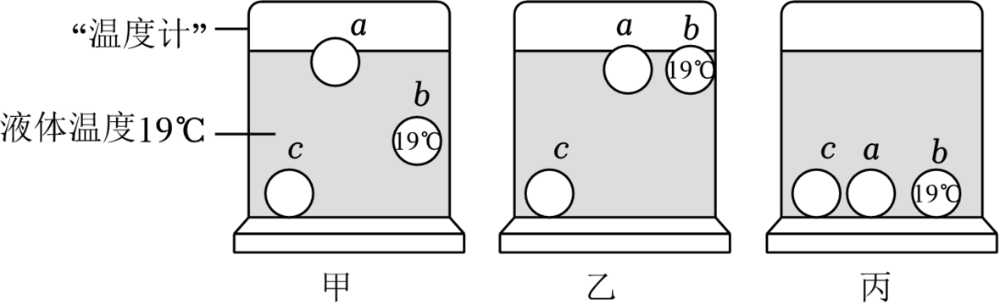

# Physics - 题目 2115

**ID**: ae6f09698ad4411fa4e32d07fcb5a88c
**年级**: Grade 9
**难度**: Medium-Hard
**题型**: Multiple-choice

## 题目
小昕自制的“温度计”中有密度随温度升高而变小的液体。​​​​​​​‌如图甲，当该液体温度为19℃时，质量为4×10^{﹣}^{3}kg小球b悬浮，b球上标记“19℃”；另外两个小球标记为“15℃”“23℃”。当小球悬浮时，它标记的温度与液体温度相等。甲、乙、丙图中的小球a、b、c均为静止，忽略小球体积变化，以下说法正确的是（      ）-

## 解答

1. A．图乙中小球c沉底，由浮沉条件可知ρ_{c}_{球}＞ρ_{乙液}，则当c球悬浮时，对应的液体密度＝c球的密度＞图乙中液体的密度，因液体的密度随温度降低而变大，所以小球c对应的温度更低，应标记为15℃，a标记应为“23℃”，故A错误；
2. B．当外界气温降低时，液体的密度变大，由F_{浮}＝ρ_{液}gV可知，小球所受浮力会变大，悬浮小球会上浮，最终会漂浮在水面上，所以此时（图2中）液体温度低于19℃，由于c球沉底，所以液体的温度高于15℃，故乙中液体温度的范围可能是16℃～18℃，故B正确；
3. C．由图丙知，三个小球都下沉，由“环境温度越高时，液体的密度变小，浮力越小，悬浮的小球会下沉”可知液体的温度比23℃还高，故C错误；
4. D．由于气温降低时，小球所受浮力会变大，悬浮小球会上浮，环境温度越高时，浮力会变小，悬浮的小球会下沉，且漂浮和悬浮时浮力都等于重力，所以15℃～19℃时浮力保持不变，温度再升高，浮力会继续变小，浮力小于重力，小球会下沉，所以19℃～23℃时浮力减小，故D错误。

## 知识点

**中文**:
  - 密度与温度的关系
  - 阿基米德原理的应用
  - 物体的浮沉条件及其应用

**English**:
  - Relationship between Density and Temperature
  - Applications of Archimedes' Principle
  - Floating/Sinking Conditions and Applications

---
