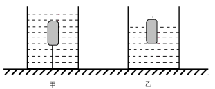

# Physics - 题目 1831

**ID**: b44099112c364bfdbb7662e32fe1ca68
**年级**: Grade 9
**难度**: Medium-Hard
**题型**: Multiple-choice

## 题目
如图甲，在水平面上的盛水容器中，一个质量分布均匀的物体被固定在容器底部的一根细线拉住后完全浸没在水中静止。​​​​​​​‌当将细线剪断后，物体漂浮在水面上，且有四分之一的体积露出水面（如图乙），比较甲、乙两图（      ）

## 解答

1. A．甲图中木块浸没在水中，浮力F_{浮甲}=ρ_{水}gV，乙图中木块漂浮，且有四分之一的体积露出水面，浮力
2. F_{浮乙}=ρ_{水}g(1- $\frac {1}{4}$ )V= $\frac {3}{4}$ρ_{水}gV
3. 则木块受到水的浮力之比
4. F_{浮甲}∶F_{浮乙}=ρ_{水}gV∶ $\frac {3}{4}$ρ_{水}gV=4∶3
5. 故A不符合题意；
6. B．容器、水、物体的重力不变，则整个装置的总重力不变，对水平面的压力不变，即容器底对水平面的压力之比1∶1，故B符合题意；
7. C．将细线剪断后，物体漂浮在水面上，且有四分之一的体积露出水面，所以
8. F_{浮}=G
9. ρ_{水}g(1- $\frac {1}{4}$ )V= $\frac {3}{4}$ρ_{水}gV=ρ_{物}gV
10. 得到
11. $\frac {ρ{{}_{物}}}{ρ{{}_{水}}}=\frac {3}{4}$
12. 故C不符合题意；
13. D．当将细线剪断后，物体漂浮在水面上，此时物体排开的水的体积变小，液面的高度会下降，由于不知道水和木块体积的具体关系，所以无法判定物体漂浮时与浸没时液面的高度的比值，所以无法判定比值的大小，故D不符合题意。
14. 故选B。

## 知识点

**中文**:
  - 物体的浮沉条件及其应用
  - 阿基米德原理的应用

**English**:
  - Floating/Sinking Conditions and Applications
  - Applications of Archimedes' Principle

---
