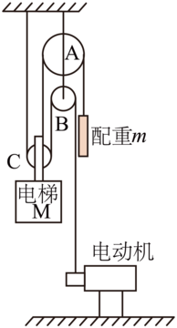

# Physics - 题目 2316

**ID**: b8431270ac48466c8e4e94288f4d5af1
**年级**: Grade 9
**难度**: Medium-Hard
**题型**: Multiple-choice

## 题目
电梯是高层住宅必备的工具。​​​​​​​‌如图所示是某种升降电梯的工作原理图，它由轿厢M、配重m、电动机、钢丝绳、定滑轮 $AB$ 、动滑轮C等部件连接组成，电梯的最大载重量指的是除开箱体质量外能承载的最大质量。配重的质量 $m=1200{\rm{k}}{\rm{g}}$ （配重看作整个系统动力的一部分），电梯箱体的质量为 ${\rm 1000}{\rm{k}}{\rm{g}}$ ，动滑轮C质量为 ${\rm 100}{\rm{k}}{\rm{g}}$ ，电动机的最大功率为43. ${\rm 5}{\rm{k}}{\rm{W}}$ ，电梯在运行过程中总是以1. ${\rm 5}{\rm{m}}{\rm{/}}{\rm{s}}$ 的速度做匀速直线运动。此时电梯向上运动，载入后总质量为 ${\rm 3900kg}$ 。不计一切摩擦和绳重， $g=10{\rm{N}}{\rm{/}}{\rm{k}}{\rm{g}}$ ，以下结论不正确的是（      ）

## 解答

1. A．整个装置中，配重拉着动滑轮的轴，与动滑轮同步运动，有三段绳子承担动滑轮与轿厢及载重的总重，则有 $2F{{}_{拉}}+G{{}_{配}}=G{{}_{总}}$
2. 电动机此时的拉力大小为 $F{{}_{拉}}=\frac {G{{}_{总}}-G{{}_{配}}}{2}=\frac {\left ({3900{\rm{k}}{\rm{g}}+100{\rm{k}}{\rm{g}}}\right )\times 10{\rm{N}}{\rm{/}}{\rm{k}}{\rm{g}}-1200{\rm{k}}{\rm{g}}\times 10{\rm{N}}{\rm{/}}{\rm{k}}{\rm{g}}}{2}=1.4\times 10{^{4}}{\rm{N}}$ ，故A正确，不符合题意；
3. B．由图可知电动机所拉绳子移动距离s与轿厢上升高度h的关系为 $s=2h$
4. 所以电动机所拉绳子移动速度v_{绳}与轿厢上升速度v_{厢}的关系为 $v{{}_{绳}}=2v{{}_{厢}}=2\times 1.5{\rm{m}}{\rm{/}}{\rm{s}}=3{\rm{m}}{\rm{/}}{\rm{s}}$
5. 电动机此时的功率为 $P=F{{}_{拉}}v{{}_{绳}}{\rm{=}}1{{.}}4\times 10{^{4}}{\rm{N}}\times 3{\rm{m}}{\rm{/}}{\rm{s}}=4.2\times 10{^{4}}{\rm{W}}$ ，故B正确，不符合题意；
6. C．电动机的最大功率为43.5kW，电动机所拉绳子移动速度一定，为3m/s，则电动机对绳子的最大拉力为 $F{{}_{大}}=\frac {P{{}_{大}}}{v{{}_{绳}}}=\frac {43.5\times 10{^{3}}{\rm{W}}}{3{\rm{m}}{\rm{/}}{\rm{s}}}=1.45\times 10{^{4}}{\rm{N}}$
7. 能提升的最大总重为 $G{{}_{总}}\mathrm{′}=2F{{}_{大}}+G{{}_{配}}=2\times 1.45\times 10{^{4}}{\rm{N}}+1200{\rm{k}}{\rm{g}}\times 10{\rm{N}}{\rm{/}}{\rm{k}}{\rm{g}}=4.1\times 10{^{4}}{\rm{N}}$
8. 该电梯的最大载重量为 $\frac {G{{}_{总}}\mathrm{′}-G{{}_{厢}}-G{{}_{动}}}{g}=\frac {G{{}_{总}}\mathrm{′}}{g}-m{{}_{厢}}-m{{}_{动}}=\frac {4{{.}}1\times 10{^{4}}{\rm{N}}}{10{\rm{N}}{\rm{/}}{\rm{k}}{\rm{g}}}-1000{\rm{k}}{\rm{g}}-100{\rm{k}}{\rm{g}}=3000{\rm{k}}{\rm{g}}$ ，故C正确，不符合题意；
9. D．该电梯最大的机械效率为 $η=\frac {W{{}_{有}}}{W{{}_{总}}}=\frac {3000{\rm{k}}{\rm{g}}\times 10{\rm{N}}{\rm{/}}{\rm{k}}{\rm{g}}\times h}{1200{\rm{k}}{\rm{g}}\times 10{\rm{N}}{\rm{/}}{\rm{k}}{\rm{g}}\times h+1.45\times 10{^{4}}{\rm{N}}\times 2h}\approx 73.2{\rm{\%}}$ ，故D错误，符合题意。

## 知识点

**中文**:
  - 功、功率、机械效率的综合计算
  - 动滑轮拉力的计算
  - 滑轮组绳子拉力的计算

**English**:
  - Comprehensive Calculation of Work, Power, and Efficiency
  - Calculating Pulling Force of Movable Pulleys
  - Calculating Rope Tension in Pulley Systems

---
