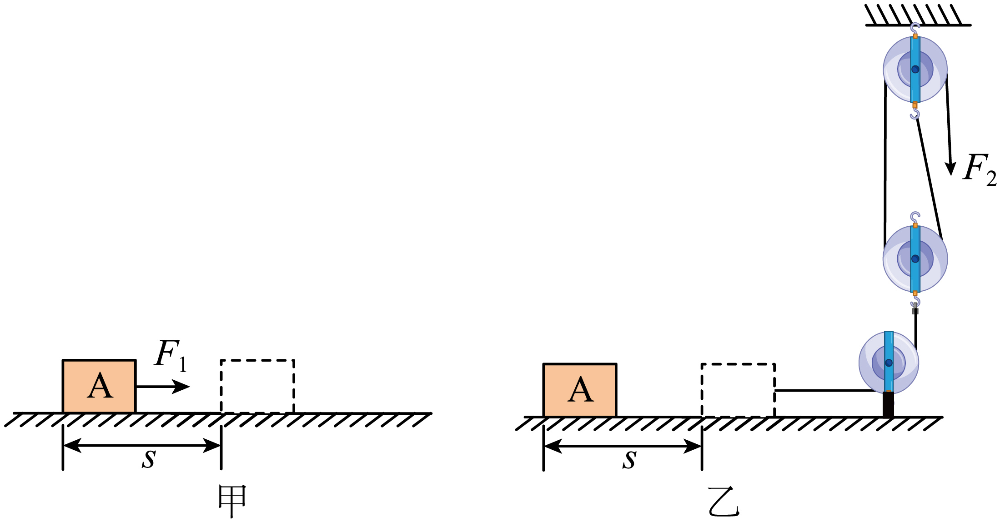

# Physics - 题目 2899

**ID**: b923ea4be64d41f889c309f80495766c
**年级**: Grade 9
**难度**: Medium-Hard
**题型**: Multiple-choice

## 题目
如图甲所示，重为G的物体A在水平拉力F_{1}（F_{1}<G）。​​​​​​​‌的作用下在水平路面上匀速直线移动一段距离s，所用时间为t，改用如图乙所示滑轮组拉动物体A在同一水平路面上用相同时间匀速直线移动相同距离，拉力为F_{2}，每个滑轮的重力为G_{0}。此过程中（      ）

## 解答

1. A．由图甲可知，物体A在水平拉力F_{1}的作用下在水平路面上匀速直线移动一段距离s，所用时间为t，则拉力F_{1}的功率为 $P=Fv=F{{}_{1}}\times \frac {s}{t}=\frac {F{{}_{1}}s}{t}$
2. 故A不符合题意；
3. B．由图乙可知，滑轮组拉动物体A在同一水平路面上用相同时间匀速直线移动相同距离，拉力为F_{2}；由对滑轮组分析可得，动滑轮上绳子股数 $n\mathrm{=}2$ ，所以滑轮组动力端移动的距离为 $s{{}_{总}}=2s$
4. 则拉力F_{2}做的总功为 $W{{}_{总}}=Fs{{}_{总}}=F{{}_{2}}\times 2s=2F{{}_{2}}s$
5. 故B不符合题意；
6. C．因为滑轮组拉动物体A在同一水平路面上用相同时间匀速直线移动相同距离，所以利用滑轮组所做的有用功与图甲中F_{1}所做的功相同，即 $W{{}_{有用}}=F{{}_{1}}s$
7. 因此滑轮组的机械效率为 $η=\frac {W{{}_{有用}}}{W{{}_{总}}}=\frac {F{{}_{1}}s}{2F{{}_{2}}s}=\frac {F{{}_{1}}}{2F{{}_{2}}}$
8. 故C不符合题意；
9. D．由题意可知，在使用滑轮组拉动物体A的过程中，额外功来源于克服摩擦所做的功、克服绳重和动滑轮自重所做的功，所以本题中克服绳重和摩擦所做的额外功为 $W{{}_{额}}{^{\prime }}=W{{}_{总}}-W{{}_{有用}}-W{{}_{额动}}=2F{{}_{2}}s-F{{}_{1}}s-G{{}_{0}}s$
10. 则所求克服绳重和摩擦所做的额外功占总功的比例为 $η^{′}=\frac {W{{}_{额}}{^{\prime }}}{W{{}_{总}}}=\frac {2F{{}_{2}}s-F{{}_{1}}s-G{{}_{0}}s}{2F{{}_{2}}s}=\frac {2F{{}_{2}}-F{{}_{1}}-G{{}_{0}}}{2F{{}_{2}}}$
11. 故D符合题意。

## 知识点

**中文**:
  - 滑轮（组）

**English**:
  - Pulleys (Systems)

---
