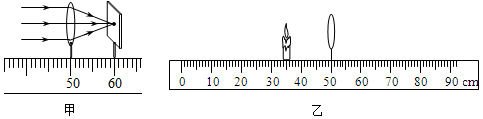

# Physics - 题目 530

**ID**: bf5f7c3d4ece4fc9b8e8a916a4240c69
**年级**: Grade 9
**难度**: Medium-Hard
**题型**: Multiple-choice

## 题目
小明在探究凸透镜成像规律时，做了如下实验：用平行光正对凸透镜照射，移动光屏得到一个最小、最亮的光斑，如图甲所示；保持该透镜位置不变，将点燃的蜡烛放在图乙所示的位置，移动光屏得到烛焰清晰的像（图中未画出）。​​​​​​​‌则下列说法正确的是（      ）①烛焰在光屏上成倒立放大的像，像到透镜的距离一定大于20cm②如果将烛焰靠近凸透镜，仍要在光屏上得到清晰的像，光屏必须远离凸透镜，且光屏移动距离小于物体移动的距离③保持物体与光屏位置不变，移动凸透镜，一定可以在光屏上得到另一个清晰的像④换用焦距较小的凸透镜，仍要在光屏上得到清晰的像，如果只移动光屏，光屏必须远离凸透镜

## 解答

1. 平行于主光轴的光线经凸透镜折射后将汇聚于点F，点F即为此透镜的焦点，从焦点到透镜中心的距离即为焦距，则透镜的焦距为 $60.0{\rm{c}}{\rm{m}}-{\rm{5}}{\rm{0}}{\rm{.}}{\rm{0}}{\rm{c}}{\rm{m}}={\rm{1}}{\rm{0}}{\rm{.}}{\rm{0}}{\rm{c}}{\rm{m}}$ 。
2. ①烛焰在光屏上成倒立放大的像，此时的像距应该大于二倍焦距，即像到透镜的距离一定大于20cm，①正确；
3. ②如果将烛焰靠近凸透镜，物距减小，像距应变大，要在光屏上得到清晰的像，光屏必须远离凸透镜；此时由于像距大于物距，则光屏移动距离要大于物体移动的距离，②错误；
4. ③保持物体与光屏位置不变，移动凸透镜，根据光路可逆可知，当物距为原来的像距时，一定可以在光屏上得到另一个清晰的像，③正确；
5. ④换用焦距较小的凸透镜，相当于增大了物距，减小了像距，仍要在光屏上得到清晰的像，如果只移动光屏，光屏必须靠近凸透镜，④错误。
6. 综上可知，C选项正确。

## 知识点

**中文**:
  - 凸透镜成像规律的动态变化问题
  - 凸透镜成像规律的应用

**English**:
  - Dynamic Changes in Convex Lens Imaging
  - Applications of Convex Lens Imaging

---
