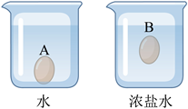

# Physics - 题目 467

**ID**: c8f7a60d993e4cd9bb5d3cd4b67d3880
**年级**: Grade 9
**难度**: Medium-Hard
**题型**: Multiple-choice

## 题目
两个完全相同的烧杯中分别装有水和浓盐水，水的密度比浓盐水的密度小，将两个鸡蛋A和B分别轻放入水中和浓盐水中，鸡蛋A下沉直至静止在烧杯底部，鸡蛋B悬浮在浓盐水中，如图所示，以下判断正确的是（      ）​​​​​​​‌

## 解答

1. A．鸡蛋A在水中下沉，则浮力小于鸡蛋的重力，合力方向向下，所以鸡蛋A刚放入水中是加速下沉，故A错误；
2. B．鸡蛋B在浓盐水中悬浮，浓盐水的密度等于鸡蛋的密度，向浓盐水中加入水，则浓盐水的密度变小，小于鸡蛋的密度，则鸡蛋B会下沉，故B错误；
3. C．如果鸡蛋A和B的体积相同，则两个鸡蛋浸在液体中的体积相等，又因为浓盐水的密度比水的密度大，根据G排=ρ液gV排可知，鸡蛋B排开液体的重力较大，故C正确；
4. D．如果鸡蛋A和B的质量相同，则重力相同，A鸡蛋在水中沉底，浮力小于重力，B鸡蛋在浓盐水中悬浮，则浮力等于重力，所以鸡蛋B在浓盐水中受到的浮力大，故D错误。
5. 故选C。

## 知识点

**中文**:
  - 实验探究物体的浮沉条件
  - 阿基米德原理的应用

**English**:
  - Experiment: Investigating Floating/Sinking Conditions
  - Applications of Archimedes' Principle

---
