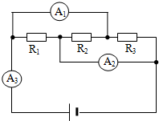

# Physics - 题目 918

**ID**: d273612c3dd0462f89f9b43bb1f8cddf
**年级**: Grade 9
**难度**: Medium-Hard
**题型**: Multiple-choice

## 题目
如图所示电路中，三个电阻器中有两个的阻值相等，电流表内阻不计，如果电流表A_{1}、A_{2}的示数分别为0.​​​​​​​‌2A和0.3A，则通过电源的电流可能是（      ）

## 解答

1. 设R_{1}、R_{2}、R_{3}中的电流分别为I_{1}、I_{2}、I_{3}，电流表A_{1}、A_{2}、A_{3}的读数分别为I_{A1}、I_{A2}、I_{A3}。由于电流表的内阻不计，相当于导线，三个电阻并联，电流表A_{1}测量通过R_{2}、R_{3}的总电流，电流表A_{2}测量通过R_{1}、R_{2}的总电流，电流表A_{3}测量通过三个电阻的总电流，由并联电路的电流特点有
2. $I{{}_{{\rm{A}}{\rm{1}}}}=I{{}_{2}}+I{{}_{3}}\cdot \cdot \cdot \cdot \cdot \cdot ①$
3. $I{{}_{{\rm{A}}{\rm{2}}}}=I{{}_{1}}+I{{}_{2}}\cdot \cdot \cdot \cdot \cdot \cdot ②$
4. 三个电阻器中有两个的阻值相等，若R_{1}=R_{2}，则I_{1}=I_{2}，由②得
5. $I{{}_{1}}=I{{}_{2}}=\frac {1}{2}I{{}_{{\rm{A}}{\rm{2}}}}=\frac {1}{2}\times 0.3{\rm{A}}=0.15{\rm{A}}$
6. 由①得
7. I_{3}=I_{A1}-I_{2}=0.2A-0.15A=0.05A
8. 则通过电源的电流（即干路电流）
9. I=I_{1}+I_{2}+I_{3}=2×0.15A+0.05A=0.35A
10. 若R_{1}=R_{3}，则I_{1}=I_{3}，由①②可得：I_{A1}应等于I_{A2}，与题不符，不可能；若R_{2}=R_{3}，则I_{2}=I_{3}，即
11. $I{{}_{2}}=I{{}_{3}}=\frac {1}{2}I{{}_{{\rm{A}}{\rm{1}}}}=\frac {1}{2}\times 0.2{\rm{A}}=0.1{\rm{A}}$
12. 由②得
13. I_{1}=I_{A2}-I_{2}=0.3A-0.1A=0.2A
14. 则通过电源的电流（即干路电流）
15. I=I_{1}+I_{2}+I_{3}=0.2A+2×0.1A=0.4A
16. 故ABD错误，C正确。
17. 故选C。

## 知识点

**中文**:
  - 并联电路的电流规律

**English**:
  - Current Law in Parallel Circuits

---
