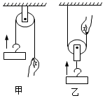

# Physics - 题目 2988

**ID**: d7d1a2b11d994c2eb676a4d753d54491
**年级**: Grade 9
**难度**: Medium-Hard
**题型**: Multiple-choice

## 题目
用图3甲、乙两种方式匀速提升重为100N的物体，已知滑轮重20N、绳重和摩擦力不计．则​​​​​​​‌

## 解答

1. 由图可知，甲滑轮是定滑轮，使用该滑轮不省力，所以拉力等于物体的重力；乙滑轮是动滑轮，使用该滑轮可以省一半的力，即拉力等于物体和滑轮总重力的一半，则手的拉力：F_{甲}＞F_{乙}；两幅图中的W_{有}是克服物体重力做的功是相同的，但乙图中拉力做功要克服动滑轮的重力做功，比甲图中做的总功要多，所以结合机械效率公式 $η=\frac {W{{}_{有}}}{W{{}_{总}}}$ 可知，有用功相同时，总功越大的，机械效率越小；
2. 所以选D．

## 知识点

**中文**:
  - 动滑轮及其工作特点
  - 定滑轮及其工作特点
  - 滑轮（组）的机械效率及其计算

**English**:
  - Movable Pulleys and Operating Characteristics
  - Fixed Pulleys and Operating Characteristics
  - Mechanical Efficiency of Pulleys and Calculations

---
