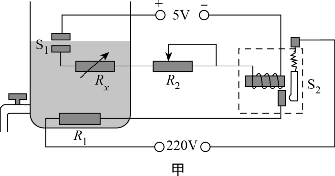

# Physics - 题目 1022

**ID**: d89b79b8feab45579eda0b454410eaff
**年级**: Grade 9
**难度**: Medium-Hard
**题型**: Multiple-choice

## 题目
热带鱼需要在一定的温度范围才能正常生长，如图甲是某同学家的水族箱工作原理图，其由控制电路和工作电路两部分组成。​​​​​​​‌水族箱内安装的电热丝 $R{{}_{1}}$ 上标有“220V200W”的字样， $R{{}_{x}}$ 为热敏电阻， $R{{}_{2}}$ 为滑动变阻器，当水面到达图中所示的位置，接触开关 ${\rm{S}}{{}_{1}}$ 就会导通，开关 ${\rm{S}}{{}_{2}}$ 被吸附闭合， $R{{}_{1}}$ 工作，水温由22℃升高到设定值28℃，开关 ${\rm{S}}{{}_{2}}$ 断开，水温自然冷却到22℃时开关 ${\rm{S}}{{}_{2}}$ 再闭合，再次使水升温，水族箱循环工作使箱内水温稳定在热带鱼正常的生长范围之内，水温随时间变化图像如图乙所示，已知。通电螺线管磁性随电流增大而增大，电流足够大时，电磁铁才能吸附 ${\rm{S}}{{}_{2}}$ 。下列说法正确的是（      ）

## 解答

1. A．由 $P=\frac {U{^{2}}}{R}$ 可得电热丝 $R{{}_{1}}$ 的阻值为
2. $R=\frac {U{{}_{额}^{2}}}{P{{}_{额}}}=\frac {{\left({220{\rm{V}}}\right)^{2}}}{200{\rm{W}}}=242{\rm{Ω}}$
3. 故A错误；
4. B．当电路中电阻变大，电流变小，是电磁铁的磁性变弱，吸引力变小，开关 ${\rm{S}}{{}_{2}}$ 会断开，因此热敏电阻 $R{{}_{x}}$ 随温度的升高而增大，故B错误；
5. C．由图乙可知，该水族箱每400分钟，电热丝R_{1}工作100分钟，一天消耗的电能为
6. $W=nPt=\frac {24\times 60}{400}\times 200{\rm{W}}\times 100\times 60{\rm{s}}{\rm{=}}{\rm{4}}{\rm{.}}{\rm{3}}{\rm{2}}\times 10{^{6}}{\rm{J}}$
7. 故C错误；
8. D．若要将水族箱内的最高温度调至30℃，热敏电阻阻值变大，电路中电流不变，总电阻不变，滑动变阻器总电阻应变小，滑片应向左移动，故D正确。
9. 故选D。

## 知识点

**中文**:
  - 电磁继电器的常见应用
  - 电磁继电器的构造及原理

**English**:
  - Common Applications of Electromagnetic Relays
  - Structure and Principle of Electromagnetic Relays

---
