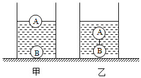

# Physics - 题目 171

**ID**: d8e085b6ac52475cbcc3e8dbfbb402bf
**年级**: Grade 9
**难度**: Medium-Hard
**题型**: Multiple-choice

## 题目
水平面上放有甲，乙两个完全相同的容器，容器中装有质量相等的不同液体。​​​​​​​‌现把质量相等的A、B两球放入甲容器中后，A漂浮、B沉底；用线把A、B两球系在一起放入乙容器中（线的质量和体积不计），静止后的状态如图所示，两容器中液面恰好相平。下列说法不正确的是（      ）

## 解答

1. A．由图可知，A、B两球排开液体的总体积
2. $V{{}_{排甲}}<V{{}_{{\rm{A}}}}+V{{}_{{\rm{B}}}}$
3. $V{{}_{排乙}}=V{{}_{{\rm{A}}}}+V{{}_{{\rm{B}}}}$
4. 所以
5. $V{{}_{排甲}}<V{{}_{排乙}}$
6. 已知甲、乙两个完全相同的容器，两容器中液面恰好相平，则
7. $V{{}_{甲}}+V{{}_{排甲}}=V{{}_{乙}}+V{{}_{排乙}}$
8. 所以
9. $V{{}_{甲}}>V{{}_{乙}}$
10. 即甲容器中液体的体积较大；已知容器中的液体质量相等，根据 $ρ=\frac {m}{V}$ 可知
11. $ρ{{}_{甲}}<ρ{{}_{乙}}$
12. 根据阿基米德原理 $F{{}_{浮}}=G{{}_{排}}$ ，则B球在甲中和乙中排开液体重力分别为
13. $G{{}_{{{}_{甲排}}}}=ρ{{}_{甲}}gV{{}_{{\rm{B}}}}$ ， $G{{}_{乙排}}=ρ{{}_{乙}}gV{{}_{{\rm{B}}}}$
14. 则
15. $G{{}_{甲排}}<G{{}_{乙排}}$
16. 故A正确，A不符合题意；
17. B．由图可知，A在甲液体中漂浮，根据漂浮条件可知
18. $F{{}_{{\rm{A}}浮甲}}=G{{}_{{\rm{A}}}}$ −−−−−−−①
19. A和B在乙液体中一起悬浮，则A球的受力情况是
20. $F{{}_{{\rm{A}}浮乙}}=G{{}_{{\rm{A}}}}+F$ −−−−−−−②
21. 由①②可知
22. $F{{}_{{\rm{A}}浮甲}}<F{{}_{{\rm{A}}浮乙}}$
23. 故B错误，B符合题意；
24. C．已知两容器中液面恰好相平，即
25. $h{{}_{甲}}=h{{}_{乙}}$
26. 因为
27. $ρ{{}_{甲}}<ρ{{}_{乙}}$
28. 根据 $p=ρgh$ 可知
29. $p{{}_{甲}}=ρ{{}_{甲}}gh{{}_{甲}}$ ， $p{{}_{乙}}=ρ{{}_{乙}}gh{{}_{乙}}$
30. 所以
31. $p{{}_{甲}}<p{{}_{乙}}$
32. 故C正确，C不符合题意；
33. D．容器对水平面的压力等于容器的总重力，即
34. $F{{}_{压}}=G{{}_{液}}+G{{}_{容}}+G{{}_{{\rm{A}}}}+G{{}_{{\rm{B}}}}$
35. 由于容器和液体质量均相等，A、B两球的质量不变，所以
36. $F{{}_{甲}}=F{{}_{乙}}$
37. 即两容器对水平面的压力相等，由于甲、乙两个完全相同的容器，则水平面的受力面积相等，根据 $p=\frac {F}{S}$ 可知
38. $p\prime {{}_{甲}}=p\prime {{}_{乙}}$
39. 即两容器对水平面的压强相等，故D正确，D不符合题意。
40. 故选B。

## 知识点

**中文**:
  - 压强大小的比较
  - 密度公式的应用
  - 阿基米德原理的应用
  - 物体的浮沉条件及其应用

**English**:
  - Comparing Pressure
  - Application of Density Formula
  - Applications of Archimedes' Principle
  - Floating/Sinking Conditions and Applications

---
