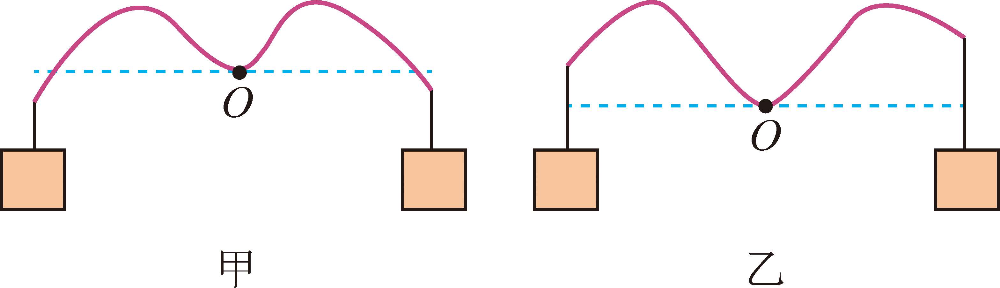

# Physics - 题目 884

**ID**: dc955881d16e4256a1039b179681f39e
**年级**: Grade 9
**难度**: Medium-Hard
**题型**: Multiple-choice

## 题目
如图所示为甲、乙两个异形杠杆，其两端均挂有重量相同的物体且均处于平衡状态，两杠杆均能围绕支点O转动。​​​​​​​‌现在两杠杆右端施加力，使其略微下降一小段距离，然后撤掉外力。关于甲、乙杠杆的平衡状况分析正确的是（      ）

## 解答

1. 如图所示的甲、乙异形杠杆，处于保持平衡状态；由于悬挂的两个重物质量相等，则作用在杠杆两端的上的拉力相等，杠杆示意图分别如下图：
2. 
3. 甲图，根据杠杆平衡条件可得GL_{1}=GL_{2}
4. 则L_{1}=L_{2}
5. 乙图，同理可得GL_{3}=GL_{4}
6. 则L_{3}=L_{4}
7. 用手使两个右端的重物略微下降一小段距离后，则杠杆示意图分别如下图：
8. 
9. 由于轻杆端点的位置不同，右端的重物略微下降一小段距离后，由力臂的变化图可知，甲硬质轻杆，L_{1}′>L_{1}，L_{2}′<L_{2}
10. 则GL_{1}′>GL_{2}′
11. 所以甲杆左端的重物会下降，则能恢复到原来平衡位置；
12. 乙硬质轻杆，L_{3}′<L_{3}，L_{4}′>L_{4}
13. 则GL_{3}′<GL_{4}′
14. 所以乙杆右端的重物会继续下降，则不能恢复到原来平衡位置，故A正确，BCD错误。

## 知识点

**中文**:
  - 杠杆的动态平衡分析

**English**:
  - Dynamic Equilibrium Analysis of Levers

---
