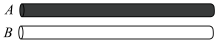

# Physics - 题目 1812

**ID**: dd20c3f3d4324a42b6d494a6534925dd
**年级**: Grade 9
**难度**: Medium-Hard
**题型**: Multiple-choice

## 题目
如图所示，A、B分别为两种不同材料制成的电阻丝，长度均为L，将A、B两根电阻丝分别接入同一电源两端时，通过的电流分别为I和2I。​​​​​​​‌现将两根电阻丝各截取一段，串接起来组成长度为L的C电阻丝（图中未展示），将电阻丝C接入同一电源两端时，通过电阻丝的电流为 $1.6I$ ，已知电阻丝的电阻值与长度成正比，则截取的电阻丝A长度是（      ）

## 解答

1. 设B电阻丝的电阻为R。根据欧姆定律有
2. U＝IR
3. 可知，在电压一定时，电流与通过导体的电流成反比，已知将A、B两根电阻丝分别接入同一电源两端时，通过的电流分别为I和2I，故A电阻丝的电阻为2R。设截取的电阻丝A长度为 $L^{′}$ ，由已知条件，B截取的长度为
4. $L-L^{′}$
5. 已知电阻丝的电阻值与长度成正比，故A截取的电阻大小为
6. $R{{}_{{\rm A}}}=\frac {L^{′}}{L}\times 2R$
7. B截取的电阻大小为
8. $R{{}_{{\rm{B}}}}=\frac {L-L^{′}}{L}\times R$
9. 因将电阻丝C接入同一电源两端时，通过电阻丝的电流为 $1.6I$ ，由电压不变时，电流与电阻成反比，故
10. $R{{}_{{\rm{C}}}}=\frac {2}{1.6}\times R=1.25R$
11. 由串联电阻的规律，由题意可知
12. $R{{}_{{\rm A}}}+R{{}_{{\rm{B}}}}=R{{}_{{\rm{C}}}}$
13. 即
14. $\frac {L^{′}}{L}\times 2R+$  $\frac {L-L^{′}}{L}\times R$  $=1.25R$
15. 解之，可得出截取的电阻丝A长度
16. $L^{′}=\frac {1}{4}L$
17. 故C符合题意，ABD不符合题意。
18. 故选C。

## 知识点

**中文**:
  - 电阻的串联

**English**:
  - Series Connection of Resistors

---
