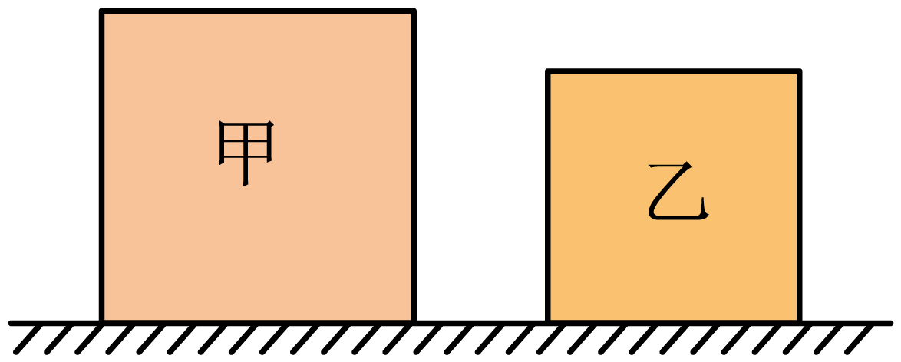

# Physics - 题目 2775

**ID**: df179509faa84ef5ac44d87ea96344e5
**年级**: Grade 9
**难度**: Medium-Hard
**题型**: Multiple-choice

## 题目
如图所示，甲、乙两个质量分布均匀的实心正方体分别放置在水平地面上，且对地面的压强相等，若沿竖直方向将甲、乙各切除一部分，使剩余部分竖直厚度相同，再将切除部分分别放在各自剩余部分上，则关于水平地面分别受到甲、乙的压力和压强，下列说法中正确的是（      ）​​​​​​​‌

## 解答

1. 如图所示，甲、乙两个质量分布均匀的实心正方体分别放置在水平地面上，且对地面的压强相等，因为S_{甲}>S_{乙}，由G=F=pS可得，G_{甲}>G_{乙}；若沿竖直方向将甲、乙各切除一部分，使剩余部分竖直厚度相同，再将切除部分分别放在各自剩余部分上，故此时各自对地面的压力大小不变，故F_{甲}>F_{乙}；由
2. $p=\frac {F}{S}=\frac {G}{S}=\frac {mg}{S}=\frac {ρVg}{S}=\frac {ρShg}{S}=ρhg$
3. 和p'_{甲}=p'_{乙}、h_{甲}>h_{乙}可得
4. $ρ{{}_{甲}}h{{}_{甲}}g{\rm{=}}ρ{{}_{乙}}h{{}_{乙}}g$
5. 则ρ_{甲}<ρ_{乙}；设剩余部分竖直厚度为h，此时甲乙的底面积S'_{甲}=h_{甲}h，S'_{乙}=h_{乙}h，此时甲对地面的压强为
6. $p{{}_{甲}}=\frac {F{{}_{甲}}{{}^{^{′}}}}{S{{}_{甲}}{{}^{^{′}}}}=\frac {G{{}_{甲}}}{S{{}_{甲}}{{}^{^{′}}}}=\frac {m{{}_{甲}}g}{S{{}_{甲}}{{}^{^{′}}}}=\frac {ρ{{}_{甲}}V{{}_{甲}}g}{S{{}_{甲}}{{}^{^{′}}}}=\frac {ρ{{}_{甲}}\left ({h{{}_{甲}}}\right ){{}^{3}}g}{h{{}_{甲}}h}{\rm{=}}\frac {ρ{{}_{甲}}\left ({h{{}_{甲}}}\right ){{}^{2}}g}{h}$
7. 此时乙对地面的压强为
8. $p{{}_{乙}}=\frac {F{{}_{乙}}{{}^{^{′}}}}{S{{}_{乙}}{{}^{^{′}}}}=\frac {G{{}_{乙}}}{S{{}_{乙}}{{}^{^{′}}}}=\frac {m{{}_{乙}}g}{S{{}_{乙}}{{}^{^{′}}}}=\frac {ρ{{}_{乙}}V{{}_{乙}}g}{S{{}_{乙}}{{}^{^{′}}}}=\frac {ρ{{}_{乙}}\left ({h{{}_{乙}}}\right ){{}^{3}}g}{h{{}_{乙}}h}{\rm{=}}\frac {ρ{{}_{乙}}\left ({h{{}_{乙}}}\right ){{}^{2}}g}{h}$
9. 因为 $ρ{{}_{甲}}h{{}_{甲}}g{\rm{=}}ρ{{}_{乙}}h{{}_{乙}}g$ ，h_{甲}>h_{乙}可得
10. $ρ{{}_{甲}}h{{}_{{{}_{甲}}}^{2}}g>ρ{{}_{乙}}h{{}_{{{}_{乙}}}^{2}}g$
11. 所以p_{甲}>p_{乙}，故ACD不符合题意，B符合题意。
12. 故选B。

## 知识点

**中文**:
  - 压力大小的比较
  - 压强大小的比较

**English**:
  - Comparing Magnitude of Pressure Force
  - Comparing Pressure

---
