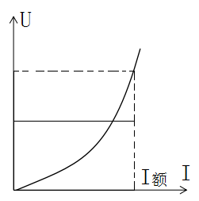

# Physics - 题目 153

**ID**: e5fd932460db44ecb75564b2722771e4
**年级**: Grade 9
**难度**: Medium-Hard
**题型**: Multiple-choice

## 题目
如图所示，是一只标有“24V 24W”的小灯泡的U-I变化图线。​​​​​​​‌下列关于该小灯泡的说法中正确的是（      ）

## 解答

1. A．小灯泡U-I图线的斜率反应出了灯丝电阻的变化，随着电压和电流增大，灯泡的电功率增大，灯丝的温度升高，灯丝的电阻增大，不能说该小灯泡的电阻随着电流的增大而增大，故A项错误；
2. B．由题意可知，灯泡的额定电压为24V，其额定电流为 $I{{}_{额}}=\frac {P{{}_{额}}}{U{{}_{额}}}=\frac {{{2}}{{4}}{\rm{W}}}{{{2}}{{4}}{\rm{V}}}{\rm{=}}{{1}}{\rm{A}}$
3. 在纵轴和横轴分别标出额定电压的一半和额定电流的一半，如图所示：
4. 
5. 由图像可知，当小灯泡两端的实际电压为12V时，其实际电流大于0.5A，所以此时的实际功率 $P{{}_{实}}=U{{}_{实}}I{{}_{实}}>{{1}}{{2}}{\rm{V}}\times {{0}}{{.}}{{5}}{\rm{A}}{\rm{=}}{{6}}{\rm{W}}$
6. 故B项错误；
7. C．由图像可知小灯泡电压为12V时U-I图线的斜率大于小灯泡电流是0.5A时U-I图线的斜率，故小灯泡两端的实际电压为12V时的电阻大于电流为0.5A时的电阻，故C项正确；
8. D．由图像可知小灯泡的电流是0.5A时，其实际电压小于12V，此时的实际功率 $P{{}_{实}}{^{\prime }}{\rm{=}}U{{}_{实}}{^{\prime }}I{{}_{实}}{^{\prime }}<{{1}}{{2}}{\rm{V}}\times {{0}}{{.}}{{5}}{\rm{A}}{\rm{=}}{{6}}{\rm{W}}$
9. 结合B项可知小灯泡两端的实际电压为12V时的电功率大于电流为0.5A时的电功率，故D项错误。

## 知识点

**中文**:
  - 实际电压与实际功率
  - 电阻的伏安特性曲线
  - 电功率的计算及应用

**English**:
  - Actual Voltage and Actual Power
  - I-V Characteristic Curve of Resistance
  - Calculation and Application of Electric Power

---
