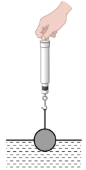

# Physics - 题目 2609

**ID**: ec53dea463264cc99cf70047f14e6a54
**年级**: Grade 9
**难度**: Medium-Hard
**题型**: Multiple-choice

## 题目
如图所示，将重为 $10{\rm{N}}$ 的小球挂在弹簧测力计下，当小球的一半体积浸在水中时，测力计示数为 $4{\rm{N}}$ 。​​​​​​​‌下列说法正确的是（      ）

## 解答

1. ${\rm A}$ ．由题知，当小球的一半体积浸在水中时受到的浮力为 $F{{}_{浮}}=G-F{{}_{示}}=10{\rm{N}}-4{\rm{N}}=6{\rm{N}}$ ，由阿基米德原理可知，小球的体积为 $V=2V{{}_{排}}=2\times \frac {F{{}_{浮}}}{ρ{{}_{水}}g}=2\times \frac {6{\rm{N}}}{1\times 10{^{3}}{\rm{k}}{\rm{g}}/{\rm{m}}{^{3}}\times 10{\rm{N}}/{\rm{k}}{\rm{g}}}=1.2\times 10{^{-3}}{\rm{m}}{^{3}}=1200{\rm{c}}{\rm{m}}{^{3}}$ ，故A错误；
2. B．由 $G=ρVg$ 可知，小球的密度为 $ρ=\frac {G}{Vg}=\frac {10{\rm{N}}}{1200\times 10{^{-6}}{\rm{m}}{^{3}}\times 10{\rm{N}}/{\rm{k}}{\rm{g}}}\approx 0.8\times 10{^{3}}{\rm{k}}{\rm{g}}/{\rm{m}}{^{3}}$ ，故B错误；
3. C．缓缓向下移动弹簧测力计，当小球全部浸没时受到的浮力为 $F{{}_{浮}}{^{\prime }}=ρ{{}_{水}}gV{{}_{排}}{^{\prime }}=ρ{{}_{水}}gV=1.0\times 10{^{3}}{\rm{k}}{\rm{g}}/{\rm{m}}{^{3}}\times 10{\rm{N}}/{\rm{k}}{\rm{g}}\times 1.2\times 10{^{-3}}{\rm{m}}{^{3}}=12{\rm{N}}$ ，小球浸没时
4. $F{{}_{浮}}{^{\prime }}>G$ ，小球会上浮，弹簧测力计对小球没有拉力，测力计的示数为0，故C错误；
5. D．当小球全部浸没时受到的浮力大于小球的重力，剪断悬吊小球的细线，小球在水中漂浮，受到的浮力为 $F{{}_{浮}}=G=10{\rm{N}}$ ，故D正确。
6. 故选 ${\rm D}$ 。

## 知识点

**中文**:
  - 浮力大小的计算
  - 重力公式的应用
  - 阿基米德原理的应用
  - 物体的浮沉条件及其应用

**English**:
  - Calculation of Buoyancy
  - Application of Gravity Formula
  - Applications of Archimedes' Principle
  - Floating/Sinking Conditions and Applications

---
