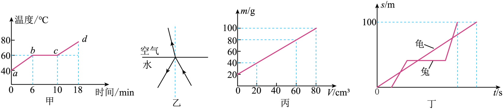

# Physics - 题目 124

**ID**: ee3cf3da3864474a97fbe786d752d3a7
**年级**: Grade 9
**难度**: Medium-Hard
**题型**: Multiple-choice

## 题目
下列选项对图中的描述正确的是（      ）​​​​​​​‌

## 解答

1. A．图中是物体熔化图像，且该物体熔化过程中有固定熔点，是晶体，在固液共存状态的过程，物体不断吸热，内能增大，故A正确；
2. B．光折射时，光从水中斜射入空气中，折射光线远离法线，折射角大于入射角，由图得，折射角小于入射角，因此不是光线从水中进入空气中的光路图，故B错误；
3. C．同种液体在同一状态下，密度一般不变，液体质量m与液体体积V的关系图像是一条过原点的图线，故C错误；
4. D．由图得，龟兔百米赛跑，兔子用时比乌龟少，由 $v=\frac {s}{t}$ 可知，全程乌龟的平均速度小于兔子，故D错误。
5. 故选A。

## 知识点

**中文**:
  - 作光的反射光路图
  - 作光的折射光路图
  - 密度定义及其特性
  - 速度的图像问题
  - 熔化的温度—时间图像

**English**:
  - Drawing Reflection Ray Diagrams
  - Drawing Refraction Ray Diagrams
  - Definition and Characteristics of Density
  - Velocity-Time Graphs
  - Temperature-Time Graph of Melting

---
