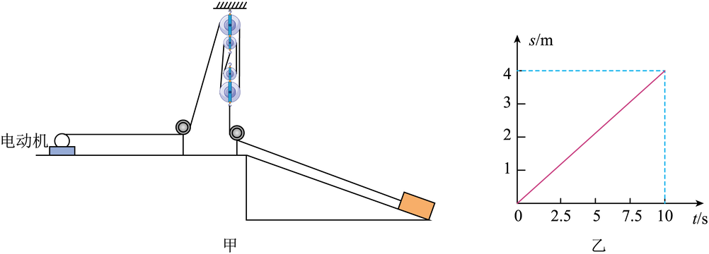

# Physics - 题目 2262

**ID**: f6d7f6fd01ef42aca8357189cfba5ea5
**年级**: Grade 9
**难度**: Medium-Hard
**题型**: Multiple-choice

## 题目
如图甲所示，电动机通过滑轮组沿斜面匀速拉动重为 $900{\rm{N}}$ 的货物，电动机的输出功率恒为 $240{\rm{W}}$ 。​​​​​​​‌ $0\sim 10{\rm{s}}$ 内货物运动的路程随时间变化关系如图乙所示，货物被提升的高度为 $2{\rm{m}}$ 。不计滑轮重、绳重及滑轮与绳的摩擦，则 $0\sim 10{\rm{s}}$ 内（      ）

## 解答

1. A．支持力的方向垂直于斜面向上，而货物的运动方向是沿斜面向上，支持力与货物的运动方向相互垂直。根据功的计算公式W=Fs，当力的方向与物体运动方向垂直时，力对物体不做功，即支持力做的功为0J，故A不符合题意；
2. B．由图乙可知，10秒内货物匀速移动了4m，因为滑轮组由4段绳子拉动物体，所以绳子自由端移动的距离s_{绳}=4s_{物}=4×4m=16m，电动机的输出功率P=240W，整个过程的时间t=10s，可先计算出电动机做的总功W_{总}=Pt=240W×10s=2400J，再根据功的计算公式W=Fs，变形可得电动机对绳子的拉力 $F=\frac {W{{}_{总}}}{s{{}_{绳}}}=\frac {{{2}}{{4}}{{0}}{{0}}{\rm{J}}}{{{1}}{{6}}{\rm{m}}}=150{\rm{N}}$ ，故B不符合题意；
3. C．货物的重力G=900N，被提升的高度h=2m，克服货物重力所做的功为有用功W_{有}=Gh=900N×2m=1800J，因为不计滑轮重、绳重及滑轮与绳的摩擦，所以额外功仅来自克服货物与斜面之间的摩擦力，即W_{额}=W_{总}－W_{有}= 2400J－1800J=600J，额外功是克服摩擦力所做的功，其计算公式为W_{额}=fs_{物}，变形可得摩擦力 $f=\frac {W{{}_{额}}}{s{{}_{物}}}=\frac {{{6}}{{0}}{{0}}{\rm{J}}}{{{4}}{\rm{m}}}=150{\rm{N}}$ ，故C符合题意；
4. D．机械效率η是有用功与总功的比值，机械效率 $η=\frac {W{{}_{有}}}{W{{}_{总}}}\times 100\%=\frac {{{1}}{{8}}{{0}}{{0}}{\rm{J}}}{{{2}}{{4}}{{0}}{{0}}{\rm{J}}}\times 100\%=75\%$ ，故D不符合题意。

## 知识点

**中文**:
  - 滑轮组及其工作特点
  - 滑轮组绳子拉力的计算
  - 滑轮（组）的机械效率及其计算

**English**:
  - Pulley Systems and Operating Characteristics
  - Calculating Rope Tension in Pulley Systems
  - Mechanical Efficiency of Pulleys and Calculations

---
