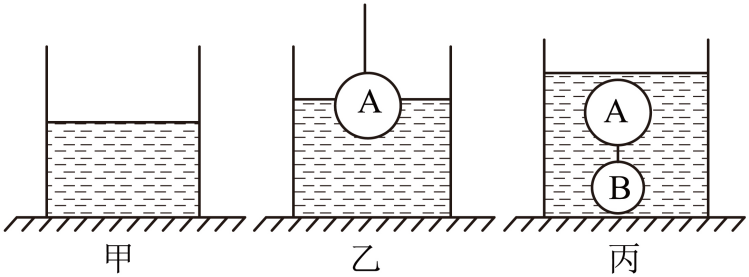

# Physics - 题目 2529

**ID**: f9f5cc3367f64d07bd3a9efcdff6b14a
**年级**: Grade 9
**难度**: Medium-Hard
**题型**: Multiple-choice

## 题目
一个盛有水的底面积为 $200{\rm{c}}{\rm{m}}{^{2}}$ 的圆柱形容器足够高，将它置于水平桌面上，如图甲所示，容器对桌面的压强为600Pa。​​​​​​​‌用细线系一小球A，将小球A体积的 $\frac {2}{3}$ 浸入水中，容器对桌面的压强为800Pa，如图乙所示；若将细线剪断，容器对桌面的压力相比乙图增大了0.8N；将小球A与一个密度为 $1.6{\rm{g}}{\rm{/}}{\rm{c}}{\rm{m}}{^{3}}$ 的球B用细线连接后置于容器中，A、B球悬浮于水中，如图丙所示。不计所有细线的体积和质量，则下列判断正确的是（      ）

## 解答

1. A．将小球A体积的 $\frac {2}{3}$ 浸入水中，容器对桌面的压强为800Pa，增加的压力为 ${\rm{Δ}}F={\rm{Δ}}pS=\left ({800{\rm{P}}{\rm{a}}-600{\rm{P}}{\rm{a}}}\right )\times 200\times 10{^{-4}}{\rm{m}}{^{{{2}}}}=4{\rm{N}}$ ，根据力的作用是相互的，小球A受到的浮力也是4N，此时排开液体的体积为 $V{{}_{排}}=\frac {F{{}_{浮}}}{ρ{{}_{水}}g}=\frac {4{\rm{N}}}{1\times 10{^{3}}{\rm{k}}{\rm{g}}{\rm{/}}{\rm{m}}{^{{{3}}}}\times 10{\rm{N}}{\rm{/}}{\rm{k}}{\rm{g}}}=4\times 10{^{-4}}{\rm{m}}{^{{{3}}}}=400{\rm{c}}{\rm{m}}{^{{{3}}}}$ ，球A的体积为 $V{{}_{{\rm{A}}}}=\frac {V{{}_{排}}}{\left ({\frac {2}{3}}\right )}=\frac {400{\rm{c}}{\rm{m}}{^{{{3}}}}}{\left ({\frac {2}{3}}\right )}=600{\rm{c}}{\rm{m}}{^{{{3}}}}$ ，故A错误；
2. B．当细线剪短后，容器对桌面的压力相比乙图增大了0.8N，即A受到的浮力比乙图又增大了0.8N，若A悬浮或者沉底，则浸没体积是乙图中的 $\frac {3}{2}$ 倍，则浮力应该增加2N，但A的浮力只增加了0.8N，故A此时为漂浮状态，浮力为 $F{{}_{浮}}=4{\rm{N}}+0.8{\rm{N}}=4.8{\rm{N}}$ ，漂浮时浮力等于重力，所以G_{A}=4.8N，A的质量为 $m{{}_{{\rm{A}}}}=\frac {G{{}_{{\rm{A}}}}}{g}=\frac {4.8{\rm{N}}}{10{\rm{N}}{\rm{/}}{\rm{k}}{\rm{g}}}=0.48{\rm{k}}{\rm{g}}=480{\rm{g}}{\rm ，A}$ 的密度为
3. $ρ{{}_{{\rm{A}}}}=\frac {m{{}_{{\rm{A}}}}}{V{{}_{{\rm{A}}}}}=\frac {480{\rm{g}}}{600{\rm{c}}{\rm{m}}{^{{{3}}}}}=0.8{\rm{g}}{\rm{/}}{\rm{c}}{\rm{m}}{^{{{3}}}}$ ，故B错误；
4. CD．当AB用细绳连接后，两者整体悬浮，所以浮力为 $F{{}_{浮1}}=\left ({m{{}_{{\rm{A}}}}+m{{}_{{\rm{B}}}}}\right )g$ ，根据阿基米德原理可知 $F{{}_{浮1}}=ρ{{}_{水}}g\left ({V{{}_{{\rm{A}}}}+V{{}_{{\rm{B}}}}}\right )$ ，又因为B密度为1.6g/cm^{3}，且 $m{{}_{{\rm{B}}}}=ρ{{}_{{\rm{B}}}}V{{}_{{\rm{B}}}}$ ，联立可解得m_{B}=320g，V_{B}=200cm^{3}，所以球B的重力为 $G{{}_{{\rm{B}}}}=m{{}_{{\rm{B}}}}g=320\times 10{^{-3}}{\rm{k}}{\rm{g}}\times 10{\rm{N}}{\rm{/}}{\rm{k}}{\rm{g}}=3.2{\rm{N}}$ ，当绳子剪断后，A漂浮，B沉底，AB整体的浮力为 $F{{}_{浮2}}=G{{}_{{\rm{A}}}}+ρ{{}_{水}}gV{{}_{{\rm{B}}}}=4.8{\rm{N}}+10{^{3}}{\rm{k}}{\rm{g}}{\rm{/}}{\rm{m}}{^{{{3}}}}\times 10{\rm{N}}{\rm{/}}{\rm{k}}{\rm{g}}\times 200\times 10{^{-6}}{\rm{m}}{^{{{3}}}}=6.8{\rm{N}}$ ，排开水的体积为 $V{{}_{1}}=\frac {F{{}_{浮2}}}{ρ{{}_{水}}g}=\frac {6.8{\rm{N}}}{10{^{3}}{\rm{k}}{\rm{g}}{\rm{/}}{\rm{m}}{^{{{3}}}}\times 10{\rm{N}}{\rm{/}}{\rm{k}}{\rm{g}}}=6.8\times 10{^{-4}}{\rm{m}}{^{{{3}}}}=680{\rm{c}}{\rm{m}}{^{{{3}}}}$ ，液面上升高度为 $Δh=\frac {V{{}_{1}}}{S}=\frac {680{\rm{c}}{\rm{m}}{^{{{3}}}}}{200{\rm{c}}{\rm{m}}{^{{{2}}}}}=3.4{\rm{c}}{\rm{m}}$ ，故C错误，D正确。

## 知识点

**中文**:
  - 压力的概念及其计算
  - 密度公式的应用
  - 阿基米德原理的应用
  - 物体的浮沉条件及其应用

**English**:
  - Concept and Calculation of Pressure Force
  - Application of Density Formula
  - Applications of Archimedes' Principle
  - Floating/Sinking Conditions and Applications

---
