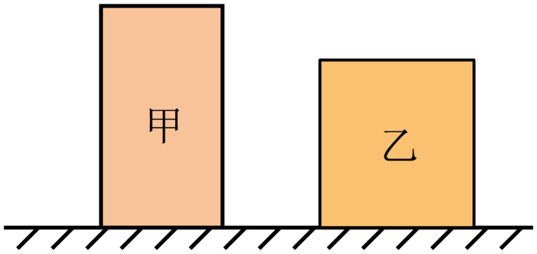

# Physics - 题目 2397

**ID**: faceffde66864863860d9c04e02533d3
**年级**: Grade 9
**难度**: Medium-Hard
**题型**: Multiple-choice

## 题目
如图，甲、乙是放在水平地面上的两个质量均匀的长方体，它们的密度之比ρ_{甲}∶ρ_{乙}=4∶5，底面积之比S_{甲}∶S_{乙}=5∶8，对水平地面的压强之比p_{甲}∶p_{乙}=6∶5，下列有关甲、乙的说法正确的是（      ）①甲、乙的质量之比是3∶4；②甲、乙的体积之比是15∶16；③将甲、乙分别沿水平方向切去相同的体积后，剩余部分对地面的压强可能相等；④将甲、乙分别沿水平方向切去相同的高度后，剩余部分对地面的压强可能相等。​​​​​​​‌

## 解答

1. ①由 $p=\frac {F}{S}$  知道，甲、乙对水平地面的压力之比
2. $\frac {F{{}_{甲}}}{F{{}_{乙}}}=\frac {p{{}_{甲}}S{{}_{甲}}}{p{{}_{乙}}S{{}_{乙}}}=\frac {6}{5}\times \frac {5}{8}=\frac {3}{4}$
3. 因水平面上物体的压力和自身的重力相等，所以，由于
4. F=G=mg
5. 所以，甲、乙的质量之比
6. $\frac {m{{}_{甲}}}{m{{}_{乙}}}=\frac {\frac {G{{}_{甲}}}{g}}{\frac {G{{}_{乙}}}{g}}=\frac {F{{}_{甲}}}{F{{}_{乙}}}=\frac {3}{4}$
7. 故①正确；
8. ②由 $ρ=\frac {m}{V}$ 知道，甲、乙的体积之比
9. $\frac {V{{}_{甲}}}{V{{}_{乙}}}=\frac {\frac {m{{}_{甲}}}{ρ{{}_{甲}}}}{\frac {m{{}_{乙}}}{ρ{{}_{乙}}}}=\frac {m{{}_{甲}}}{m{{}_{乙}}}\times \frac {ρ{{}_{乙}}}{ρ{{}_{甲}}}=\frac {3}{4}\times \frac {5}{4}=\frac {15}{16}$
10. 故②正确；
11. ③水平面上物体的压力和自身的重力相等，所以，物体对地面的压强
12. $p=\frac {F}{S}=\frac {G}{S}=\frac {mg}{S}=\frac {ρVg}{S}$
13. 切去相同体积时，两者压强的变化量分别为
14. $Δp{{}_{甲}}=\frac {ρ{{}_{甲}}ΔVg}{S{{}_{甲}}}$
15. $Δp{{}_{乙}}=\frac {ρ{{}_{乙}}ΔVg}{S{{}_{乙}}}$
16. 则
17. $\frac {Δp{{}_{甲}}}{Δp{{}_{乙}}}=\frac {\frac {ρ{{}_{甲}}ΔVg}{S{{}_{甲}}}}{\frac {ρ{{}_{乙}}ΔVg}{S{{}_{乙}}}}=\frac {ρ{{}_{甲}}}{ρ{{}_{乙}}}\times \frac {S{{}_{乙}}}{S{{}_{甲}}}=\frac {4}{5}\times \frac {8}{5}=\frac {32}{25}$
18. 所以
19. $Δp{{}_{甲}}＞Δp{{}_{乙}}$
20. 已知原来甲乙对水平地面的压强之比
21. p_{甲}∶p_{乙}=6∶5
22. 则
23. p_{甲}＞p_{乙}
24. 由于剩余部分对地面的压强
25. $p\prime =p-Δp$
26. 所以剩余部分对地面的压强可能相等，故③正确；
27. ④由于水平面上的柱状物体对地面的压强可以利用p=ρgh比较，则切去相同的高度后，两者压强的变化量分别为
28. $Δp{{}_{甲}}\prime =ρ{{}_{甲}}gΔh\\Δp{{}_{乙}}\prime =ρ{{}_{乙}}gΔh$
29. 已知它们的密度之比
30. ρ_{甲}∶ρ_{乙}=4∶5
31. 所以
32. $Δp{{}_{甲}}\prime ＜Δp{{}_{乙}}\prime $
33. 已知原来甲乙对水平地面的压强之比
34. p_{甲}∶p_{乙}=6∶5
35. 则
36. p_{甲}＞p_{乙}
37. 由于剩余部分对地面的压强
38. $p\prime =p-Δp$
39. 所以剩余部分对地面的压强不可能相等，故④错误。
40. 综上分析知道，只有①②③正确，故A正确。
41. 故选A。

## 知识点

**中文**:
  - 固体压强的判断与计算

**English**:
  - Determination and Calculation of Solid Pressure

---
