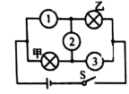

# Physics - 题目 928

**ID**: ffc1cf2eec064f0db8feab3fff096881
**年级**: Grade 9
**难度**: Medium-Hard
**题型**: Multiple-choice

## 题目
如图所示，闭合开关，两只灯泡甲和乙能发光，则关于1、2、3三个学生实验电表（电流表或电压表），下列说法正确的是（      ）​​​​​​​‌

## 解答

1. 第一种情况：如果把2去掉，这样我们就能看出电路中有两条支路： ${\rm{L}}{{}_{乙}}$ 与 1串联在一条支路中，所以1就是电流表；  ${\rm{L}}{{}_{甲}}$ 与3串联在一条支路中，所以3是电流表；2与两个灯泡并联，是电压表． 第二种情况：如果把1和3去掉，这样我们就能看出 ${\rm{L}}{{}_{甲}}$ 、2、 ${\rm{L}}{{}_{乙}}$ 在一条支路上，此时电路为串联电路，所以2就是电流表；1因为与灯 ${\rm{L}}{{}_{甲}}$ 并联，所以是电压表；3与灯 ${\rm{L}}{{}_{乙}}$ 并联，所以是电压表． 由此分析可知：1、2、3是电流表，还是电压表，取决于灯泡的连接方式，但1、3一定是同类型的表．故选D．

## 知识点

**中文**:
  - 电压表的使用
  - 电流表的使用

**English**:
  - Using a Voltmeter
  - Using an Ammeter

---
