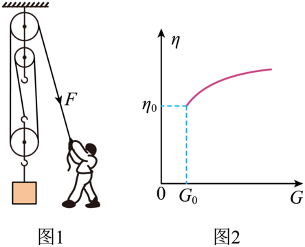

# Physics - 题目 2151

**ID**: 11e8a3145cf944b0b1bce0e10a310328
**年级**: Grade 9
**难度**: Medium-Hard
**题型**: Multiple-select

## 题目
某工人用如图1所示的滑轮组运送货物上楼，滑轮组的机械效率随货物重力变化的图像如图2所示。​​​​​​​‌若工人在t_{0}时间内将重为G_{0}的货物匀速向上提升h_{0}高度。下列说法正确的是（不计绳重和摩擦）（      ）

## 解答

1. A．由图可知，绳子承重段数为3，根据机械效率 $η=\frac {W{{}_{有}}}{W{{}_{总}}}=\frac {Gh}{Fs}=\frac {Gh}{Fnh}=\frac {G}{nF}$ 可得，此时工人所用的拉力为 $F=\frac {G{{}_{0}}}{n\times η{{}_{0}}}=\frac {G{{}_{0}}}{3η{{}_{0}}}$ ，故A正确；
2. B．工人在t_{0}时间内将重为G_{0}的货物匀速向上提升h_{0}高度，可得绳末端移动的速度为 $v=\frac {s}{t}=\frac {3h{{}_{0}}}{t{{}_{0}}}$
3. 工人所用拉力做功的功率为 $P=Fv=\frac {G{{}_{0}}}{3η{{}_{0}}}\times \frac {3h{{}_{0}}}{t{{}_{0}}}=\frac {G{{}_{0}}h{{}_{0}}}{η{{}_{0}}t{{}_{0}}}$ ，故B错误；
4. C．不计绳重和摩擦，根据 $F=\frac {1}{n}\left ({G+G{{}_{动}}}\right )$ ，可得动滑轮的重力为 $G{{}_{动}}=3F-G{{}_{0}}=3\times \frac {G{{}_{0}}}{3η{{}_{0}}}-G{{}_{0}}=\frac {\left ({1-η{{}_{0}}}\right )}{η{{}_{0}}}\times G{{}_{0}}$
5. 故C正确；
6. D．若工人将2G_{0}的货物匀速提升h_{0}高度，绳末端的拉力为 $F^{′}=\frac {1}{3}\left ({G^{′}+G{{}_{动}}}\right )=\frac {1}{3}\times \left ({2G{{}_{0}}+\frac {\left ({1-η{{}_{0}}}\right )}{η{{}_{0}}}\times G{{}_{0}}}\right )=\frac {G{{}_{0}}η{{}_{0}}+G{{}_{0}}}{3η{{}_{0}}}$
7. 则滑轮组的机械效率为 $η^{′}=\frac {G^{′}}{nF^{′}}=\frac {2G{{}_{0}}}{3\times \frac {G{{}_{0}}η{{}_{0}}+G{{}_{0}}}{3η{{}_{0}}}}=\frac {2G{{}_{0}}η{{}_{0}}}{G{{}_{0}}η{{}_{0}}+G{{}_{0}}}=\frac {2η{{}_{0}}}{η{{}_{0}}+1}$
8. 故D正确。

## 知识点

**中文**:
  - 滑轮（组）

**English**:
  - Pulleys (Systems)

---
