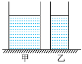

# Physics - 题目 2180

**ID**: 157ae9389146449ea5ab51781b136c88
**年级**: Grade 9
**难度**: Medium-Hard
**题型**: Multiple-select

## 题目
甲乙两个圆柱形容器盛相同深度的酒精和水，放置于水平桌面上，如图所示，甲乙两容器的底面积分别为 $S{{}_{1}}$ 和 $S{{}_{2}}$ ，且 $4S{{}_{1}}=5S{{}_{2}}.$ 将等质量的塑料块和铁块分别放入甲乙两容器中，塑料块有 $\frac {3}{4}$ 的体积浸在酒精中静止，已知。​​​​​​​‌ $ρ{{}_{塑}}<ρ{{}_{酒}}<ρ{{}_{水}}<ρ{{}_{铁}}$ ， $5ρ{{}_{酒}}=4ρ{{}_{水}}$ ， $13ρ{{}_{塑}}=ρ{{}_{铁}}.$ 下列说法正确的是（      ）

## 解答

1. A．根据题意知道，甲乙两容器的容积比
2. $\frac {V{{}_{甲}}}{V{{}_{乙}}}=\frac {S{{}_{甲}}h}{S{{}_{乙}}h}=\frac {S{{}_{甲}}}{S{{}_{乙}}}=\frac {5}{4}$
3. 又因为 $5ρ{{}_{酒}}=4ρ{{}_{水}}$ ，则甲乙两容器的液体质量比
4. $\frac {m{{}_{甲}}}{m{{}_{乙}}}=\frac {ρ{{}_{酒精}}V{{}_{甲}}}{ρ{{}_{水}}V{{}_{乙}}}=\frac {4\times 5}{5\times 4}=1$ ：1
5. 即
6. $G{{}_{甲}}$ ： $G{{}_{乙}}=1$ ：1
7. 因为柱形容器，所以液体对容器底的压力等于液体的重力，甲乙容器底部受到液体的压力相等，A正确；
8. B．放入物体后，塑料块漂浮在酒精中，所以浮力等于塑料块的重力，由力的作用的相互性知道，增大的压力等于塑料块的重力；而铁块放入水中后下沉水中，所受浮力小于铁块的重力，根据力的作用相互性，增大的压力小于铁块的重力；所以甲容器底部受到液体的压力大，故B正确；
9. C．因为 $5ρ{{}_{酒}}=4ρ{{}_{水}}$ ，则
10. $ρ{{}_{酒精}}=\frac {4}{5}ρ{{}_{水}}=0.8{\rm{g}}{\rm{/}}{\rm{c}}{\rm{m}}{^{3}}$
11. 又因为塑料块有 $\frac {3}{4}$ 的体积浸在酒精中静止，则
12. $ρ{{}_{塑料}}gV=ρ{{}_{酒精}}g\frac {3}{4}V$
13. 即
14. $ρ{{}_{塑料}}=\frac {3}{4}ρ{{}_{酒精}}=\frac {3}{4}\times 0.8{\rm{g}}{\rm{/}}{\rm{c}}{\rm{m}}{^{3}}=0.6{\rm{g}}{\rm{/}}{\rm{c}}{\rm{m}}{^{3}}$
15. 故解得
16. $ρ{{}_{铁}}=13ρ{{}_{塑料}}=13\times 0.6{\rm{g}}{\rm{/}}{\rm{c}}{\rm{m}}{^{{\rm{3}}}}{\rm{=}}{\rm{7}}{\rm{.}}{\rm{8}}{\rm{g}}{\rm{/}}{\rm{c}}{\rm{m}}{^{{\rm{3}}}}$
17. 故C错误；
18. D．塑料块所受的浮力
19. $F{{}_{浮}}=mg$
20. 铁块完全浸没在水中，则
21. $F{{}_{浮}}^{′}=ρ{{}_{水}}g\frac {m}{ρ{{}_{铁}}}$
22. 则
23. $\frac {F{{}_{浮}}}{F{{}_{浮}}^{′}}=\frac {mg}{\frac {mρ{{}_{水}}g}{ρ{{}_{铁}}}}=\frac {ρ{{}_{铁}}}{ρ水}=\frac {{\rm{7}}{\rm{.}}{\rm{8}}{\rm{g}}{\rm{/}}{\rm{c}}{\rm{m}}{^{{\rm{3}}}}}{{\rm{1}}{\rm{g}}{\rm{/}}{\rm{c}}{\rm{m}}{^{{\rm{3}}}}}=\frac {39}{5}$
24. 故D正确。
25. 故选ABD。

## 知识点

**中文**:
  - 压力的概念及其计算
  - 阿基米德原理的应用

**English**:
  - Concept and Calculation of Pressure Force
  - Applications of Archimedes' Principle

---
