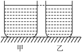

# Physics - 题目 2024

**ID**: 299eae29c9f842eb8115e7e1e26b1287
**年级**: Grade 9
**难度**: Medium-Hard
**题型**: Multiple-select

## 题目
如图所示，甲、乙两个不同的烧杯放在水平桌面上，其中分别装有质量相同的不同液体，此时两杯中的液面相平。​​​​​​​‌将一个物体分别放入甲、乙两杯液体中，液体均未溢出，最终物体在甲杯液体中沉底，在乙杯液体中漂浮。下列判断正确的是（      ）

## 解答

1. A．物体放入甲杯沉底，说明物体的密度大于甲杯中液体的密度，物体在乙杯中漂浮，说明物体的密度小于乙杯中液体的密度，故甲杯中液体的密度小于乙杯中液体的密度，故A正确；
2. B．物体放入甲杯沉底，说明物体在甲杯中受到的浮力小于自身重力，物体在乙杯中漂浮，说明物体所受浮力等于自身重力，则物体在甲杯中受到的浮力小于在乙杯中受到的浮力，故B正确；
3. C．甲、乙杯中液体质量相同，故液体对容器底的压力也相同，故C错误；
4. D．甲、乙杯中液体质量相同，两杯中的液面相平，而甲杯中液体的密度较小，故甲杯中液体的体积较大，则甲杯底面积较大，当液体对容器底的压力相同时，甲杯中液体对容器底的压强小于乙杯中液体对容器底的压强，故D正确。
5. 故选ABD。

## 知识点

**中文**:
  - 压力大小的比较
  - 压强大小的比较
  - 物体的浮沉条件及其应用

**English**:
  - Comparing Magnitude of Pressure Force
  - Comparing Pressure
  - Floating/Sinking Conditions and Applications

---
