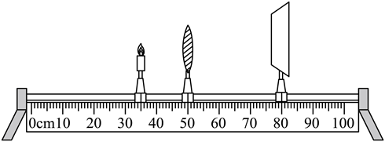

# Physics - 题目 2343

**ID**: 2e1a109bb439496aa60b2bdd75c73c9b
**年级**: Grade 9
**难度**: Medium-Hard
**题型**: Multiple-select

## 题目
在探究“凸透镜成像规律”的实验中，蜡烛、凸透镜、光屏固定位置如图，此时在光屏上得到一个清晰的像。​​​​​​​‌下列说法正确的是（      ）

## 解答

1. A．由图示知，蜡烛与凸透镜的距离小于光屏与凸透镜的距离，即物距小于像距，所以在光屏上成的是倒立、放大的实像，故A正确；
2. B．图示位置，物距小于像距，光屏上可成清晰像，根据光路可逆原理可知，将凸透镜向右适当移动一段距离，当物距和像距长度正好互换时，仍可在光屏上得到一个清晰的像，此时为倒立、缩小的实像，故B正确；
3. C．将蜡烛远离凸透镜适当距离，物距等于二倍焦距时，同时将光屏适当靠近凸透镜时，光屏上可得到倒立、等大的实像，故C错误；
4. D．在图示的蜡烛和凸透镜之间放一个远视镜，需要将光屏向左移动，才能在光屏上得到清晰的像，因为远视镜是凸透镜，对光有会聚作用，蜡烛的光经远视镜被会聚了，再经凸透镜，则蜡烛的光的会聚点变近，故D正确。
5. 故选ABD。

## 知识点

**中文**:
  - 凸透镜成像规律的动态变化问题
  - 凸透镜成像规律的探究实验

**English**:
  - Dynamic Changes in Convex Lens Imaging
  - Experiment: Imaging Rules of Convex Lenses

---
