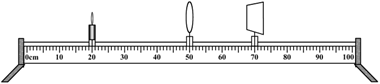

# Physics - 题目 1805

**ID**: 39e7f31c31cd4b7187b6034b8cc728b4
**年级**: Grade 9
**难度**: Medium-Hard
**题型**: Multiple-select

## 题目
如图所示，蜡烛经凸透镜恰好在光屏上成最清晰的像，下列说法正确的是（      ）​​​​​​​‌

## 解答

1. A．由图可知，物距为
2. 50cm-20cm=30cm
3. 像距为
4. 70cm-50cm=20cm
5. 由凸透镜成像规律可知物距
6. u=30cm＞2f
7. f＜15cm
8. 像距
9. 2f＞v=20cm＞f
10. 20cm＞f＞10cm
11. 所以凸透镜焦距
12. 15cm＞f＞10cm
13. 故A正确；
14. B．在光的折射现象中光路是可逆的，保持蜡烛和光屏的位置不动，将凸透镜向左移动10cm，此时物距为20cm，像距为30cm，光屏会出现倒立、放大的实像，投影仪应用此原理，故B错误；
15. C．蜡烛与光屏不动，如果凸透镜没有替换，根据光路的可逆性，凸透镜向左移动到某一位置，光屏上能接收到蜡烛清晰的像，但是将图中凸透镜用焦距f=15cm的凸透镜替换，蜡烛和光屏之间的距离至少是60cm才能成像，物距和像距都改变了，蜡烛和光屏之间的距离是50cm，此时凸透镜向左移动到某一位置，光屏上不能接收到蜡烛清晰的像，故C错误；
16. D．蜡烛与凸透镜位置不动，紧贴凸透镜左侧放一镜片，若向右移动光屏可以接收到蜡烛清晰的像，说明该透镜对光有发散作用，所以该镜片为凹透镜，即近视眼镜片，故D正确。
17. 故选AD。

## 知识点

**中文**:
  - 凸透镜成像规律的动态变化问题
  - 凸透镜成像规律的应用

**English**:
  - Dynamic Changes in Convex Lens Imaging
  - Applications of Convex Lens Imaging

---
