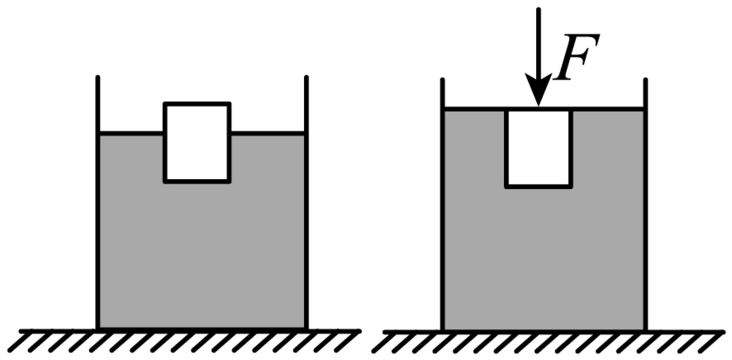

# Physics - 题目 136

**ID**: 67dcb93c2f3f4b849e9187f977d1dad0
**年级**: Grade 9
**难度**: Medium-Hard
**题型**: 双选题

## 题目
水平面上有一个底面积为S的薄壁圆柱形容器，容器中装有质量为m_{1}的水，现将一质量为m_{2}的物块放入容器中，物块漂浮在水面上，如图所示，物块浸入水中的体积为物块体积的 $\frac {3}{5}$ ；用力缓慢向下压物块直至物块恰好浸没在水中（水未溢出），如图所示。​​​​​​​‌下列说法正确的是（已知水的密度是ρ_{0}）（      ）

## 解答

1. A．现将一质量为m_{2}的物块放入容器中，物块漂浮在水面上，由物体的浮沉条件可知，F_{浮}=G。由F_{浮}=ρ_{液}V_{排}g和G=mg可得
2. $ρ{{}_{0}}\times \frac {3}{5}Vg=m{{}_{2}}g$
3. 物块的体积为
4. $V=\frac {5m{{}_{2}}}{3ρ{{}_{0}}}$ ①
5. 故A错误；
6. B．质量为m_{2}的物块漂浮在水面上，由物体的浮沉条件可知，F_{浮}=G。由F_{浮}=ρ_{液}V_{排}g和G=mg=ρVg可得
7. $ρ{{}_{0}}\times \frac {3}{5}Vg=m{{}_{2}}g=ρ{{}_{物}}Vg$
8. 物块的密度为
9. $ρ{{}_{物}}=\frac {3ρ{{}_{0}}}{5}$
10. 故B正确；
11. C．用力缓慢向下压物块直至物块恰好浸没在水中（水未溢出），物块在竖直方向上受到竖直向上的浮力和竖直向下重力和压力F。则压力F的大小为
12. $F=F{{}_{浮}}-G=ρ{{}_{0}}V{{}_{排}}g-m{{}_{2}}g$ ②
13. 由物块浸没在水中可知，V_{排}=V。再将①式代入②式可得，压力F的大小为
14. $F=ρ{{}_{0}}Vg-m{{}_{2}}g=ρ{{}_{0}}\frac {5m{{}_{2}}}{3ρ{{}_{0}}}g-m{{}_{2}}g=\frac {2}{3}m{{}_{2}}g$
15. 故C错误；
16. D．图中水的深度为
17. $h=\frac {V{{}_{总}}}{S}=\frac {\frac {m{{}_{1}}}{ρ{{}_{0}}}+\frac {m{{}_{2}}}{ρ{{}_{物}}}}{S}=\frac {\frac {m{{}_{1}}}{ρ{{}_{0}}}+\frac {5m{{}_{2}}}{3ρ{{}_{0}}}}{S}$
18. 由p=ρgh可知，水对容器底部的压强为
19. $p=ρ{{}_{0}}gh=ρ{{}_{0}}g\frac {\frac {m{{}_{1}}}{ρ{{}_{0}}}+\frac {5m{{}_{2}}}{3ρ{{}_{0}}}}{S}=\frac {\left ({3m{{}_{1}}+5m{{}_{2}}}\right )g}{3S}$
20. 故D正确。
21. 故选BD。

## 知识点

**中文**:
  - 液体压强计算公式的应用
  - 阿基米德原理的应用
  - 物体的浮沉条件及其应用

**English**:
  - Application of Liquid Pressure Formula
  - Applications of Archimedes' Principle
  - Floating/Sinking Conditions and Applications

---
