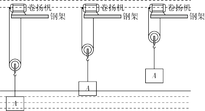

# Physics - 题目 1828

**ID**: 6d97403d93d0448e854089bb19cbe707
**年级**: Grade 9
**难度**: Medium-Hard
**题型**: Multiple-select

## 题目
用如图所示的装置将体积为10dm^{3}，重为900N的重物A从水中提升出来。​​​​​​​‌在卷扬机对绳子的拉力作用下，使A经历了三个过程：过程I为A浸没在水中竖直匀速上升的过程，过程Ⅱ为A上表面刚露出水面到下表面刚离开水面竖直匀速上升的过程，过程Ⅲ为A在空中竖直匀速上升的过程。过程Ⅲ中卷扬机对绳子的拉力大小为F=500N。不计水中提升时水对A的阻力，不计A被提出水面所带水的质量，下列判断中正确的是（      ）

## 解答

1. A．从图中可以看到，这是一个动滑轮，若过程Ⅰ和过程Ⅲ中提升A的高度相同，那么卷扬机的绳子自由端移动的距离也相同；过程Ⅰ中重物A匀速上升，处于平衡状态，受到重力G_{A}、卷扬机的绳子拉力 $F{{}_{拉}}$ 、水的浮力 $F{{}_{浮}}$ 的作用而处于平衡状态，即
2. $G{{}_{{\rm{A}}}}=F{{}_{拉}}+F{{}_{浮}}$
3. 过程Ⅲ中重物A匀速上升，处于平衡状态，受到重力G_{A}、卷扬机的绳子拉力 $F{{}_{拉}^{^{′}}}$ 的作用而处于平衡状态，即
4. $G{{}_{{\rm{A}}}}=F{{}_{拉}^{^{′}}}$
5. 从上面两式可知 $F{{}_{拉}^{^{′}}}>F{{}_{拉}}$ ，而卷扬机的绳子自由端移动的距离s相同，则过程Ⅰ和过程Ⅲ所做的总功
6. $W{{}_{1}}=F{{}_{拉}}s$
7. $W{{}_{{\rm{3}}}}=F{{}_{拉}^{^{′}}}s$
8. 那么 $W{{}_{{\rm{1}}}}<W{{}_{{\rm{3}}}}$ ；过程Ⅰ和过程Ⅲ中所做的有用功，重物A重力相同，升高的高度相同，那么两个过程所做的有用功相同，设为 $W{{}_{有用功}}$ ，那么过程Ⅰ和过程Ⅲ中所做的额外功
9. $W{{}_{{\rm{1}}额}}=W{{}_{{\rm{1}}}}-W{{}_{有用功}}$
10. $W{{}_{{\rm{3}}额}}=W{{}_{{\rm{3}}}}-W{{}_{有用功}}$
11. $W{{}_{{\rm{1}}}}<W{{}_{{\rm{3}}}}$ ，则 $W{{}_{{\rm{1}}额}}<W{{}_{{\rm{3}}额}}$ ，即两过程中所做的额外功不相同，故A错误；
12. B．由A解析可知过程Ⅰ中
13. $F{{}_{拉}}=G{{}_{{\rm{A}}}}-F{{}_{浮}}$
14. 过程Ⅱ中，重物A所受的浮力在变小，对这个过程的重物A受力分析，受到重力、变小的浮力、卷扬机的绳子拉力作用，即
15. $G{{}_{{\rm{A}}}}=F{{}_{拉}^{^{′′}}}+F{{}_{浮}^{^{′}}}$
16. 转化可得
17. $F{{}_{拉}^{^{′′}}}=G{{}_{{\rm{A}}}}-F{{}_{浮}^{^{′}}}$
18. 那么可知 $F{{}_{拉}^{^{′′}}}$ 在不断变大，过程I和过程Ⅱ中卷扬机对绳子的拉力大小一定不相同，故B正确；
19. C．由题意可知，过程Ⅲ中卷扬机对绳子的拉力大小为F=500N，重物A上升的高度设为h，两条绳子托着动滑轮，那么绳子自由端移动的距离 $s=2h$ ，重物A重为900N，过程Ⅲ中提升A的机械效率
20. $η=\frac {W{{}_{有用功}}}{W{{}_{总功}}}\times {\rm{1}}{\rm{0}}{\rm{0}}{\rm{\%}}=\frac {G{{}_{{\rm{A}}}}h}{F{{}_{拉}}s}\times {\rm{1}}{\rm{0}}{\rm{0}}{\rm{\%}}=\frac {{\rm{9}}{\rm{0}}{\rm{0}}{\rm{N}}\cdot h}{{\rm{5}}{\rm{0}}{\rm{0}}{\rm{N}}\cdot {\rm{2}}h}\times {\rm{1}}{\rm{0}}{\rm{0}}{\rm{\%}}={\rm{9}}{\rm{0}}{\rm{\%}}$
21. 过程Ⅲ中提升A的机械效率 $η$ 为90%，故C正确；
22. D．根据
23. $W{{}_{额外功}}=W{{}_{总功}}-W{{}_{有用功}}$
24. 可知
25. $G{{}_{动滑轮}}\cdot h={\rm{5}}{\rm{0}}{\rm{0}}{\rm{N}}\cdot {\rm{2}}h-{\rm{9}}{\rm{0}}{\rm{0}}{\rm{N}}\cdot h$
26. 解得 $G{{}_{动滑轮}}={\rm{1}}{\rm{0}}{\rm{0}}{\rm{N}}$ ，此装置中动滑轮的重力为100N，故D正确。
27. 故选BCD。

## 知识点

**中文**:
  - 有用功、额外功和总功的计算
  - 滑轮组绳子拉力的计算
  - 滑轮（组）的机械效率及其计算

**English**:
  - Calculation of Useful, Extra, and Total Work
  - Calculating Rope Tension in Pulley Systems
  - Mechanical Efficiency of Pulleys and Calculations

---
