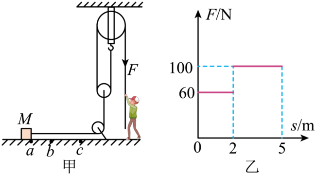

# Physics - 题目 29

**ID**: 7be4f5617dc240d3ae6f3e17a8af32ab
**年级**: Grade 9
**难度**: Medium-Hard
**题型**: Multiple-select

## 题目
如图甲所示装置，小欢用力F向下拉绳子，使物体M在水平地面匀速移动，地面ab、bc粗糙程度不同。​​​​​​​‌物体M重为400N，动滑轮重为5N，ab=2m，bc=3m。物体M从a点到c点过程中，拉力F与M移动距离的关系如图乙，不考虑物体大小对运动的影响，忽略绳子重力及滑轮转轴摩擦，对此过程的分析，下列结论正确的是（      ）

## 解答

1. A．由图可知，绳子段数有2段，物体移动的距离s_{物}=2m+3m=5m，则绳子自由端移动的距离为s=5m×2=10m，故A错误；
2. B．由图乙可知，物体M从a点到b点过程中，拉力F'=60N，绳子自由端移动距离s'=2m×2=4m
3. 拉力F做的功为W'=F's'=60N×4m=240J，物体M从b点到c点过程中，拉力F"=100N，绳子自由端移动距离s"=3m×2=6m，拉力F做的功为W"=F"s"=100N×6m=600J，则拉力F做的总功为W=240J+600J=840J，故B正确；
4. C．忽略绳子重力及滑轮转轴摩擦，拉力F在ab段做的额外功W_{额}'=G_{动}s_{ab}=5N×2m=10J，拉力F在bc段做的额外功W_{额}"=G_{动}s_{bc}=5N×3m=15J，所以拉力F在ab段做的额外功小于在bc段做的额外功，故C错误；
5. D．在ab段，滑轮组的机械效率 $η^{′}=\frac {W{{}_{有}}{^{^{′}}}}{W{{}_{总}}{^{^{′}}}}\times 100{\rm{\%}}{\rm{=}}\frac {W{{}_{总}}{^{^{′}}}{{-}}W{{}_{额}}{^{^{′}}}}{W{{}_{总}}{^{^{′}}}}\times 100{\rm{\%}}{\rm{=}}\frac {{{2}}{{4}}{{0}}{\rm{J}}-{{1}}{{0}}{\rm{J}}}{{{2}}{{4}}{{0}}{\rm{J}}}≈96{\rm{\%}}$ ，在bc段，滑轮组的机械效率 $η{^{^{′′}}}=\frac {W{{}_{有}}{^{^{′′}}}}{W{{}_{总}}{^{^{′′}}}}\times 100{\rm{\%}}{\rm{=}}\frac {W{{}_{总}}{^{^{′′}}}{{-}}W{{}_{额}}{^{^{′′}}}}{W{{}_{总}}{^{^{′′}}}}\times 100{\rm{\%}}{\rm{=}}\frac {600{\rm{J}}-15{\rm{J}}}{600{\rm{J}}}=97.5{\rm{\%}}$ ，故D正确。
6. 故选BD。

## 知识点

**中文**:
  - 有用功、额外功和总功的计算
  - 滑轮组及其工作特点
  - 机械效率的大小比较

**English**:
  - Calculation of Useful, Extra, and Total Work
  - Pulley Systems and Operating Characteristics
  - Comparing Mechanical Efficiency

---
