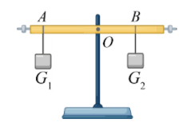

# Physics - 题目 125

**ID**: 8291304ce41f47a9a764cec53f5268d6
**年级**: Grade 9
**难度**: Medium-Hard
**题型**: 双选题

## 题目
如图所示，将体积相同的物体G_{1}、G_{2}分别挂在杠杆的两端杠杆处于平衡状态。​​​​​​​‌若将两个物体G_{1}、G_{2}分别浸没在水中和煤油中，则（      ）

## 解答

1. 将体积相同的物体G_{1}、G_{2}分别挂在杠杆的两端杠杆处于平衡状态，故
2. $G{{}_{1}}l{{}_{A}}=G{{}_{2}}l{{}_{B}}$
3. 从图中可以看出
4. $l{{}_{A}}>l{{}_{B}}$
5. 水的密度大于煤油的密度，G_{1}、G_{2}的体积相同，将两个物体G_{1}、G_{2}分别浸没在水中和煤油中，由 $F{{}_{浮}}=ρVg$  得，G_{1}受到的浮力F_{1}比G_{2}受到的浮力F_{2}大， 此时杠杆A点受到的力为
6. $G{{}_{1}}-F{{}_{1}}$
7. 杠杆B点受到的力为
8. $G{{}_{2}}-F{{}_{2}}$
9. 此时
10. $G{{}_{1}}l{{}_{A}}-F{{}_{1}}l{{}_{A}}<G{{}_{2}}l{{}_{B}}-F{{}_{2}}l{{}_{B}}$
11. 故杠杆不能平衡，杠杆B端将下沉。适当增大力臂lA或者减小力臂lB，可以使杠杆平衡。因此若将G_{1}向左移动少许杠杆可能处于平衡。故AC不符合题意，BD符合题意。
12. 故选BD。

## 知识点

**中文**:
  - 杠杆的动态平衡分析
  - 阿基米德原理的应用

**English**:
  - Dynamic Equilibrium Analysis of Levers
  - Applications of Archimedes' Principle

---
