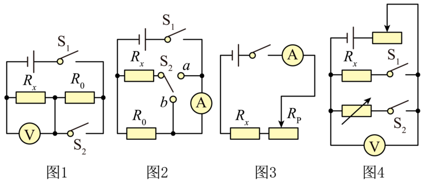

# Physics - 题目 2144

**ID**: bdfa2022e069478b9f290d47e94c037c
**年级**: Grade 9
**难度**: Medium-Hard
**题型**: Multiple-select

## 题目
以下方法中电源电压均保持不变，R_{0}为已知阻值的定值电阻，滑动变阻器的最大阻值也是R_{0}，那么能够测出未知电阻R_{X}的阻值的方法是（      ）​​​​​​​‌

## 解答

1. A．如图1，先只闭合开关 ${\rm{S}}{{}_{1}}$ ，此时两电阻串联，测出R_{X}两端电压U_{X}，再闭合开关 ${\rm{S}}{{}_{2}}$ ，此时 $R{{}_{0}}$ 被短路，电压表测的是电源电压U，根据串联电路分压规律可得
2. $\frac {R{{}_{{\rm{X}}}}}{R{{}_{0}}}=\frac {U{{}_{{\rm{X}}}}}{U{{}_{0}}}=\frac {U{{}_{{\rm{X}}}}}{U-U{{}_{{\rm{X}}}}}$
3. 则
4. $R{{}_{{\rm{X}}}}=\frac {U{{}_{{\rm{X}}}}}{U-U{{}_{{\rm{X}}}}}R{{}_{0}}$
5. 故A符合题意；
6. B．如图2，先闭合开关 ${\rm{S}}{{}_{1}}$ ，开关 ${\rm{S}}{{}_{2}}$ 分别接a测的是通过 $R{{}_{0}}$ 的电流 $I{{}_{a}}$ ，开关 ${\rm{S}}{{}_{2}}$ 分别接b，测的是干路电流测出电流 $I{{}_{b}}$ ，根据并联电路分流的规律可得
7. $\frac {R{{}_{{\rm{X}}}}}{R{{}_{0}}}=\frac {I{{}_{a}}}{I{{}_{{\rm{R}}{{}_{{\rm{X}}}}}}}=\frac {I{{}_{a}}}{I{{}_{b}}-I{{}_{a}}}$
8. 则
9. $R{{}_{{\rm{X}}}}=\frac {I{{}_{a}}}{I{{}_{b}}-I{{}_{a}}}R{{}_{0}}$
10. 故B符合题意；
11. C．先将滑片移到最右端后闭合开关，此时 $R{{}_{{\rm{P}}}}=R{{}_{0}}$ ，此时两电阻串联，测出电流I，则电源电压为
12. $U=I\left ({R{{}_{0}}+R{{}_{{\rm{x}}}}}\right )$      ①
13. 再将滑片移到最左端时 $R{{}_{{\rm{P}}}}=0$ 时，电路中只有 $R{{}_{{\rm{x}}}}$ ，测出电流I，则电源电压为
14. $U=I{{}_{{\rm{x}}}}R{{}_{{\rm{x}}}}$       ②
15. 联立①②解得
16. $R{{}_{{\rm{x}}}}=\frac {I}{I{{}_{{\rm{x}}}}-I}R{{}_{0}}$
17. 故C不符合题意；
18. D．如图4，先断开所有开关调节滑动变阻器阻值为最大值，再闭合开关 ${\rm{S}}{{}_{1}}$ ，断开开关 ${\rm{S}}{{}_{2}}$ ，调节滑动变阻器到适当位置，测出R_{X}两端电压
19. $U{{}_{{\rm{X}}}}={\rm{\;}}U{{}_{1}}$
20. 然后保持滑动变阻器滑片位置不动，断开开关 ${\rm{S}}{{}_{1}}$ 、闭合开关 ${\rm{S}}{{}_{2}}$ ，调节电阻箱的阻值为 $R{{}_{1}}$ ，使电压表的示数为 $U{{}_{1}}$ ，则
21. $R{{}_{{\rm{X}}}}=R{{}_{1}}$
22. 故D符合题意。
23. 故选ABD。

## 知识点

**中文**:
  - 其他方法测电阻

**English**:
  - Other Methods for Measuring Resistance

---
