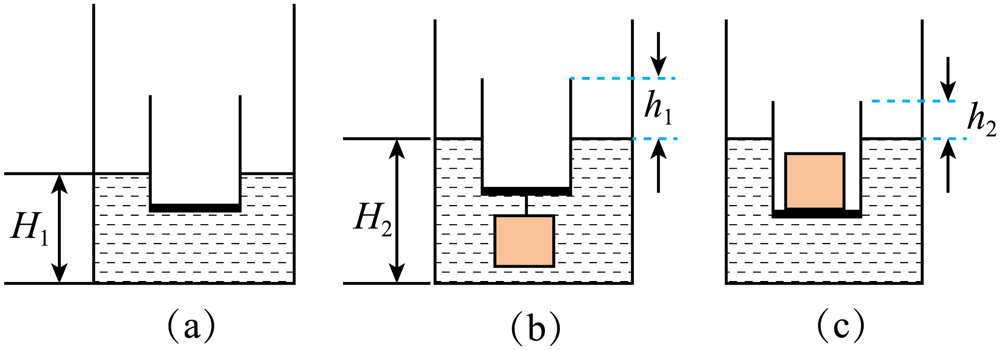

# Physics - 题目 951

**ID**: e6169c15074943cab34b2206f324d981
**年级**: Grade 9
**难度**: Medium-Hard
**题型**: Multiple-select

## 题目
小明同学用刻度尺、圆柱形容器、有配重的薄壁长烧杯和水、细线等材料，测出了金属块的密度（如图）。​​​​​​​‌操作过程如下：①在圆柱形容器中装有适量的水，将一只装有配重的薄壁长烧杯放入圆柱形容器的水中，烧杯静止时用刻度尺测出容器中水的深度为H_{1}，如图（a）所示；②将金属块吊在烧杯底部，烧杯静止时用刻度尺测出烧杯露出水面的高度h_{1}，容器中水的深度为H_{2}，如图（b）所示；③将金属块放在烧杯中，烧杯静止时用刻度尺测出烧杯露出水面的高度h_{2}，如图（c）所示。则下列说法正确的是（      ）

## 解答

1. 图（a）中，薄壁长烧杯漂浮在水中，所受的浮力等于自身的重力，据阿基米德原理知，长烧杯的重力等于它排开水的总重力，A正确；图（b）中，金属块和长烧杯一起漂浮在水面，所受的重力等于金属块和长烧杯的总重力。图（c）中，金属块和长烧杯仍然漂浮在水面，所受的浮力等于自身的重力，则两个图中，金属块和长烧杯所受的浮力相等，排开的水的体积相等，圆柱形容器内水的深度相同，据 $p=ρgh$ 知，水对容器底的压强相等，B错误；忽略细线的重力，图（b）中，容器对桌面的压力等于圆柱开容器、容器中水及金属块和长烧杯的总重力，图（c）中，容器对桌面的压力等于圆柱形容器、容器中水及金属块和长烧杯的总重力，容器中的水重力保持不变，所以容器对桌布的压力不变，据 $p=\frac {F}{S}$ 知，两个图中容器对桌面的压强相等，C正确；比较（a）、（b）两图可知，都是漂浮，受到的浮力都等于自重，则两图中浮力的变化量等于金属块重力，两图中浮力的变化量 $ΔF{{}_{浮}}=ρ{{}_{水}}gΔV{{}_{排}}=ρ{{}_{水}}g\left ({H{{}_{2}}-H{{}_{1}}}\right )S{{}_{1}}$ ，金属块的重力为 $G=ρ{{}_{水}}g\left ({H{{}_{2}}-H{{}_{1}}}\right )S{{}_{1}}$ ，比较（b）、（c）两图可知，都是漂浮，烧杯和金属块的总重不变，总浮力不变；则（b）图中金属块受到的浮力等于这两次烧杯受到的浮力变化量，金属块受到的浮力 $ρ{{}_{水}}gV{{}_{排}}=ρ{{}_{水}}gV=ρ{{}_{水}}g\left ({h{{}_{1}}-h{{}_{2}}}\right )S{{}_{2}}$ ，所以金属块的体积为 $V{{}_{金}}=\left ({h{{}_{1}}-h{{}_{2}}}\right )S{{}_{2}}$ ，金属块的密度为 $ρ{{}_{金}}=\frac {m{{}_{金}}}{V{{}_{金}}}=\frac {\frac {G}{g}}{V{{}_{金}}}=\frac {\frac {ρ{{}_{水}}g(H{{}_{2}}-H{{}_{1}})S{{}_{1}}}{g}}{(h{{}_{1}}-h{{}_{2}})S{{}_{2}}}=\frac {ρ{{}_{水}}(H{{}_{2}}-H{{}_{1}})S{{}_{1}}}{(h{{}_{1}}-h{{}_{2}})S{{}_{2}}}$ ，故D错误。

## 知识点

**中文**:
  - 特殊方法测密度

**English**:
  - Special Methods for Measuring Density

---
