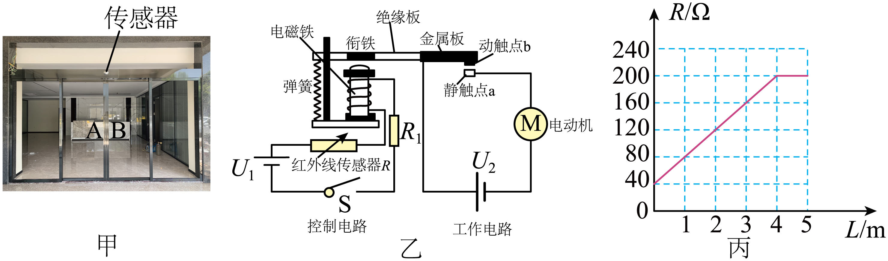

# Physics - 题目 850

**ID**: 04df9804c1654dcdb66a94bf8f92abcc
**年级**: Grade 9
**难度**: Medium-Hard
**题型**: Science Reading

## 题目
阅读下面的短文，回答问题。​​​​​​​‌电动自动玻璃门小明进入商场时，发现商场大门采用的是电动自动玻璃门。当小明靠近玻璃门时，玻璃门A、B自动滑向两侧开门，如图甲箭头方向所示；无人通行时，玻璃门自动关闭。电动自动玻璃门装置中的电路如图乙所示。控制电路主要元件：电磁铁（不计电磁铁线圈的电阻）、电源（电压恒定为U₁）、红外线传感器R、定值电阻R_{1}=120Ω工作电路主要元件：静触点a、动触点b、电源（电压恒定为 $U₂=24V$ ）电动机。当电磁铁线圈中的电流为50mA时，衔铁刚好被吸下，动触点b与静触点α接触，电动机开始工作，玻璃门被打开。红外线传感器R的电阻随人体到大门的距离L的变化关系如图丙所示。（1）小明走近玻璃门的过程中，在玻璃门上所成像的大小（选填“变大”“变小”或“不变”）；当小明走到距离玻璃门L=2m时，刚好触发电动机工作，带动左右两扇玻璃门滑向两侧而开门，若玻璃门滑动过程中小明不动，则他的像的位置（选填“不变”或“改变”）；通过计算，控制电路的电源电压U₁为V。（2）闭合开关S时，电磁铁上端是极。（3）若将一个电压表并联在R两端，则电压表示数U_{R}随L的变化关系式为。

## 解答

1. （1）平面镜所成的是正立、等大的虚像，当小明走近玻璃门的过程中，小明的大小不变，则他所成的像的大小不变。
2. 平面镜所成的像与物体关于镜面对称，玻璃门滑向两侧过程中，小明相对玻璃门所在的对称面的位置不变，则其所成的像位置不变。
3. 由丙知当L为2m时，R=120Ω，此时电路中的总电阻为
4. $R{{}_{总}}=R+R{{}_{1}}{\rm{=}}120{\rm{Ω}}+120{\rm{Ω}}=240{\rm{Ω}}$
5. 控制电路的电源电压U₁为
6. $U{{}_{1}}=IR{{}_{总}}=50\times 10{^{-3}}{\rm{A}}\times 240{\rm{Ω}}=12{\rm{V}}$
7. （2）通电后电流从电磁铁的下端流入，上端流出，根据安培定则可判断电磁铁的上端为N极。
8. （3）由图丙可知，R与L的数学关系为
9. $R=40L+40(4{\rm{m}}⩾L⩾0)$    ①
10. 根据串联电路的分压规律有
11. $\frac {U{{}_{{\rm{R}}}}}{U{{}_{1}}-U{{}_{{\rm{R}}}}}=\frac {R}{R{{}_{1}}}$
12. 将U_{1}=12V，R_{1}=120Ω，代入化简得
13. $U{{}_{{\rm{R}}}}=\frac {12R}{120+R}$ ； ②
14. 将①式代入②式得
15. $U{{}_{{\rm{R}}}}=\frac {12L+12}{4+L}(4{\rm{m}}⩾L⩾0)$
16. 当L>4m时，R不再改变，始终为200Ω，则
17. $U{{}_{{\rm{R}}}}=\frac {U{{}_{1}}}{R+R{{}_{1}}}\times R=\frac {12{\rm{V}}}{200{\rm{Ω}}+120{\rm{Ω}}}\times 200{\rm{Ω}}=7.5{\rm{V}}$

## 知识点

**中文**:
  - 安培定则及其应用
  - 平面镜成像的特点、原理及现象
  - 欧姆定律的应用
  - 电路的动态分析

**English**:
  - Ampere's Rule and Applications
  - Characteristics, Principles, and Phenomena
  - Applications of Ohm's Law
  - Dynamic Circuit Analysis

---
