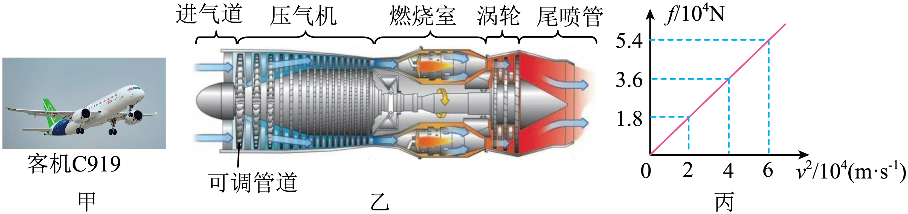

# Physics - 题目 634

**ID**: 3d5f30603d604d5da40a0ddad0a85b6b
**年级**: Grade 9
**难度**: Medium-Hard
**题型**: Science Reading

## 题目
阅读短文，回答问题。​​​​​​​‌涡轮喷气发动机2023年5月28日上午，我国首架自行研制、拥有自主知识产权的喷气式客机 ${\rm{C}}919$ ，如图甲，历时2h从上海到北京，开启了首次商业载客飞行。如图乙所示，为 ${\rm{C}}919$ 客机使用的轴流式涡轮喷气发动机，其结构是由进气道、压气机、燃烧室、涡轮和尾喷管组成，其中压气机与涡轮装在同一条转轴上工作，皀刉前先进入发动机的进气道，当飞机飞行时，由于飞机飞行的速度是变化的，而进入压气机气流速度有一定限制，使进入进气道的气体全部通过可调管道，空气流过压气机时被压气机的旋转叶片压缩后进入燃烧室，产生的高温高压气流推动涡轮，一边带动压气机正常工作。${\rm{C}}919$ 客机搭载的涡轮喷气发动机，其部分参数如下表，其中热效率是指涡轮喷气发动机获得的机械能与燃料完全燃烧产生的内能之比；推进效率指推力克服空气阻力所做的功与其获得的机械能之比。热效率 $η{{}_{1}}$40%推进效率 $η{{}_{2}}$60%航空燃油热值q$5.0\times 10{^{7}}{\rm{J}}{\rm{/}}{\rm{k}}{\rm{g}}$（1）涡轮喷气发动机在工作中，空气流过压气机时用方式改变空气的内能（选填“做功”或“热传递”），这部分气体与燃料混合后在燃烧室中燃烧，燃烧产生的高温高压气流推动涡轮；此过程的能量转化相当于热机的冲程；（2）关于涡轮喷气发动机，下列说法不正确的是（多选）；

## 解答

1. （1）空气流过压气机时，被压气机的旋转叶片压缩 后进入燃烧室，因此旋转叶片对气体做功，气体的内能增大，所以用做功的方式改变空气的内能。
2. 四冲程热机中的做功冲程就是利用内能来做功的冲程，将内能转化为机械能，这部分气体与燃料混合后在燃烧室中燃烧，产生的高温高压气流推动涡轮，这一过程的能量转化，相当于热机工作时的做功冲程。
3. （2）A．根据题中信息可知进气道中吸入的气体是空气，故A正确，不符合题意；
4. B．燃料耗尽后，不会产生高温高压气流，无法推动涡轮，故B错误，符合题意；
5. C．燃烧室中，燃料燃烧，将化学能转化为内能，故C错误，符合题意；
6. D．尾喷管中喷出的高速气流推进飞机前进，对飞机做功，故D正确，不符合题意。
7. （3）能将机外−50℃以下的冷空气不断压缩，导致送入舱内的空气温度达到50℃以上，由于人体正常体温约为37℃，人体感觉舒适的温度约25℃，所以机体上的空调要不断制冷，使舱内气压和温度达到舒适值。
8. （4）由图丙f—v^{2}的图像可知，当飞机以200m/s的水平速度匀速巡航时，受到的阻力为3.6×10^{4}N，飞机受到推力和阻力是平衡力，所以推力
9. F=f=3.6×10^{4}N
10. 在巡航1h的过程中克服阻力做的功
11. $W=Fs=Fvt=3.6\times 10{^{4}}{\rm{N}}\times 200{\rm{m}}/{\rm{s}}\times 3600{\rm{s}}=2.592\times 10{^{10}}{\rm{J}}$ 推进效率为60%，获得的机械能
12. $W{{}_{机}}=\frac {W}{η{{}_{2}}}=\frac {2.592\times 10{^{10}}{\rm{J}}}{60\%}=4.32\times 10{^{10}}{\rm{J}}$ 热效率为40%，航空燃油完全燃烧放出的热量
13. $Q{{}_{放}}=\frac {W{{}_{机}}}{η{{}_{1}}}=\frac {4.32\times 10{^{10}}{\rm{J}}}{40\%}=1.08\times 10{^{11}}{\rm{J}}$
14. 需要航空燃油的质量
15. $m=\frac {Q{{}_{放}}}{q}=\frac {1.08\times 10{^{11}}{\rm{J}}}{5\times 10{^{7}}{\rm{J}}/kg}=2160kg$
16. （5）从能量转化的角度看，内燃机在压缩冲程中，将机械能转化为内能，所以燃气的温度升高；在做冲程中，气体推动活塞对外做功，将气体的内能转化为活塞的机械能，燃气温度降低，所以混合气体温度随时间而变化先升高后降低，故B符合题意，ACD不符合题意。

## 知识点

**中文**:
  - 有关热机效率的计算
  - 能量的转化

**English**:
  - Calculations of Heat Engine Efficiency
  - Transformation of Energy

---
