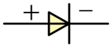
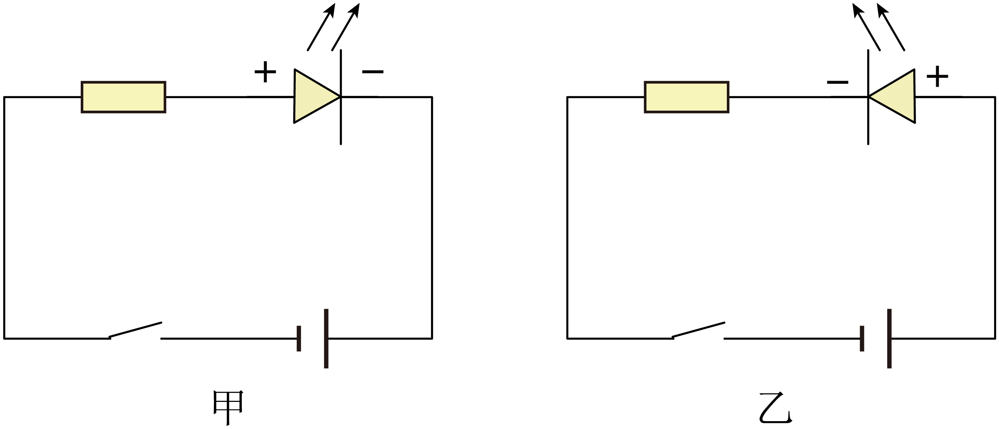

# Physics - 题目 2846

**ID**: 5f3628ac30ec4105b8945b84bbb25d85
**年级**: Grade 9
**难度**: Medium-Hard
**题型**: Science Reading

## 题目
请根据上述材料，回答下列问题。​​​​​​​‌LED灯LED灯又叫发光二极管，它主要由硅、砷等半导体材料制成，具有光效高、耗电少、寿命长、易控制、免维护、安全环保等优点，是继白炽灯、卤素灯和节能荧光灯后的新兴电光源，是极具发展前途的新光源。LED灯的主要部分是高亮度白色发光二极管，发光二极管只是二极管中的一种，二极管的电路图符号是“”，由于二极管具有单向导电性，所以当电流从二极管的正极（+）流进二极管时，二极管导通；而电流从二极管的负极（-）流入时，二极管断路，不会有电流通过二极管。与传统的白炽灯、卤素灯、荧光灯相比，LED灯具有许多不同之处。首先，LED灯基本上是一块很小的芯片被封装在环氧树脂里面，所以它非常的小而轻。其次，由于白炽灯的发光原理是通过电流加热灯丝到白炽状态，从而利用热辐射发出可见光，所以白炽灯在使用时约90%以上的电能都转化成了内能，只有不足10%的电能才真正转化成我们需要的光能，而LED灯可以直接把电能转化为光能，它的转化效率可达到80%以上。第三，从使用寿命来看，普通白炽灯的额定寿命约1000h，荧光灯的额定寿命约5000h，而LED灯的额定寿命约50000h。另外，与荧光灯相比，LED灯不含汞等有害元素，更加环保，利于回收。（1）为了探究发光二极管的导电性，连接了如图甲、乙所示的两个电路，在没有电路故障时，闭合开关，能点亮发光二极管的是（选填“甲”或“乙”）图；（2）LED灯可以把电能直接转化为能，它之所以节能，被称为冷光源，是因为电热转换时损耗的能量较白炽灯（选填“高”或“低”）（3）40W的LED灯和300W的卤素灯正常发光时亮度相同，某公园为了节约能源，将公园的路灯由100盏300W的卤素灯全部换成40W的LED灯。假设每天照明10h，使用LED灯后，每天可以节约电能kW·h；

## 解答

1. （1）二极管具有单向导电性，电流从正极（+）流进时导通，从负极（−）流入时断路。甲图中，电流从发光二极管的负极流入，二极管断路，不能点亮；乙图中，电流从发光二极管的正极流入，二极管导通，能点亮。所以能点亮发光二极管的是乙图。
2. （2）由材料内容可知，LED灯可以直接把电能转化为光能，它的转化效率可达到80%以上，而白炽灯只有不足10%的电能才真正转化成我们需要的光能，因此LED灯电热转换时损耗的能量较白炽灯低。
3. （3）卤素灯功率 $P{{}_{1}}=300{\rm{W}}=0.3{\rm kW}$
4. LED灯功率 $P{{}_{2}}=40{\rm{W}}=0.04{\rm kW}$
5. 则一盏灯的功率差 ${\rm{Δ}}P=P{{}_{1}}-P{{}_{2}}=0.3{\rm kW}-0.04{\rm kW}=0.26{\rm kW}$
6. 总功率差 $P{{}_{总差}}=100\times {\rm{Δ}}P=100\times 0.26{\rm kW}=26{\rm kW}$
7. 由 $P=\frac {W}{t}$ 可知，每天可以节约电能 $W=P{{}_{总差}}\times t=26{\rm kW}\times 10{\rm{h}}=260{\rm kW}·{\rm{h}}$
8. 所以，使用 LED 灯后，每天可以节约电能260kW·h。

## 知识点

**中文**:
  - 探究二极管的单向导电性
  - 电功率的计算及应用

**English**:
  - Investigation: Unidirectional Conductivity of Diodes
  - Calculation and Application of Electric Power

---
