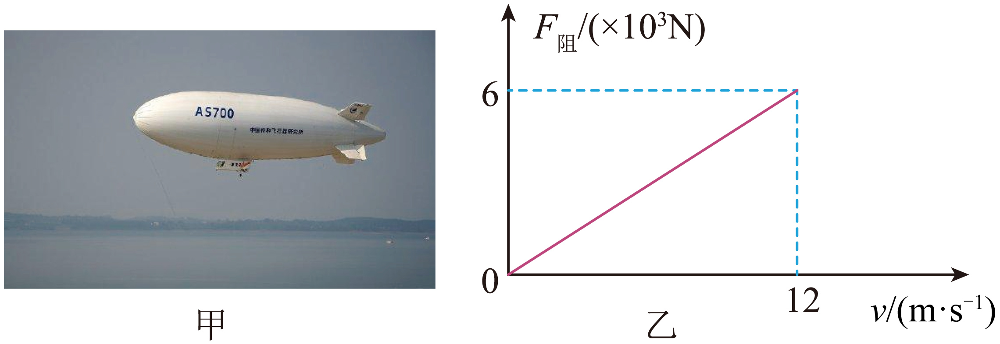

# Physics - 题目 2984

**ID**: edf95b61b5fd46eba3c0fd236c5d5f67
**年级**: Grade 9
**难度**: Medium-Hard
**题型**: Science Reading

## 题目
阅读短文，回答问题。​​​​​​​‌载人飞艇2024年3月30日，我国自主研制的“祥云”AS700载人飞艇成功完成首飞。某飞艇如图甲所示，其气囊体积巨大，采用轻质材料制作。飞艇升空靠浮力来实现，水平飞行靠燃油发动机提供动力。燃油发动机输出的能量用于做推动功和辅助功：推动功指克服空气阻力推动飞艇水平飞行做的功；辅助功指燃油发动机驱动飞艇上发电机工作所做的功，辅助功的功率恒定。当飞艇低速 $\left ({v⩽12{\rm{m}}/{\rm{s}}}\right )$ 水平直线飞行时，其受到的空气阻力 $F{{}_{阻}}$ 与速度v的关系如图乙所示。飞艇部分参数见表。忽略气囊厚度及气囊外其他部分受到的浮力。空载质量（不含氦气）3750kg气囊总容积$4200{\rm{m}}{^{3}}$燃油发动机效率36%辅助功的功率$5\times 10{^{4}}{\rm{W}}$（1）气囊采用轻质材料制作是为了减小；（2）飞艇的发电机利用的原理发电；（3）将气囊充满氦气，此时飞艇受到的浮力为N，飞艇最多可载位乘客升空；（每位乘客质量 $m=60{\rm{k}}{\rm{g}}$ ， $ρ{{}_{空气}}=1.2{\rm{k}}{\rm{g}}/{\rm{m}}{^{3}}$ ， $ρ{{}_{氦气}}=0.2{\rm{k}}{\rm{g}}/{\rm{m}}{^{3}}$ ， $g=10{\rm{N}}/{\rm{k}}{\rm{g}}$ ）（4）飞艇以6m/s的速度水平匀速直线飞行时，其受到的空气阻力为N；若以此速度水平匀速直线飞行10min，那么发动机推动功为J，辅助功为J；（5）飞艇低速水平匀速直线飞行时，若消耗10kg燃油，可飞行的最大距离为km。（燃油热值 $q{{}_{油}}=4.5\times 10{^{7}}{\rm{J}}/{\rm{k}}{\rm{g}}$ ）

## 解答

1. （1）根据G=mg可知，在g一定时，质量m越小，重力G越小。气囊采用轻质材料制作，是为了减小气囊的质量，从而减小飞艇的自重，使飞艇更容易升空。
2. （2）发电机是利用电磁感应原理工作的，即闭合电路的一部分导体在磁场中做切割磁感线运动时，导体中就会产生电流。
3. （3）因为飞艇浸没在空气中，所以V_{排}=V_{气囊}=4200m^{3}
4. 根据阿基米德原理可得飞艇受到的浮力F_{浮}=ρ_{空气}gV_{排}=1.2kg/m^{3}×10N/kg×4200m^{3}=5.04×10^{4}N
5. 飞艇的总重力G_{总}等于飞艇自身的重力G_{艇}、氦气的重力G_{氦}和乘客的总重力G_{人}之和，当飞艇刚好能升空时，F_{浮}=G_{总}。飞艇自身的重力G_{艇}=m_{艇}g=3750kg×10N/kg=3.75×10^{4}N
6. 氦气的质量m_{氦}=ρ_{氦气}V_{气囊}=0.2kg/m^{3}×4200m^{3}=840kg
7. 氦气的重力G_{氦}=m_{氦}g=840kg×10N/kg=8.4×10^{3}N
8. 设最多可载n位乘客，则G_{人}=nmg，由F_{浮}=G_{艇}+G_{氦}+G_{人}可得5.04×10^{4}N=3.75×10^{4}N+8.4×10^{3}N+n×60kg×10N/kg
9. 解得n=7.5，因为乘客数量必须为整数，所以飞艇最多可载7位乘客升空。
10. （4）由图乙可知，当飞艇低速（v≤12m/s）水平直线飞行时，空气阻力F_{阻}与速度v成正比，设F_{阻}=kv，当v=12m/s时，F_{阻}=6×10^{3}N，则 $k=\frac {F{{}_{阻}}}{v}=\frac {6\times 10{^{3}}{\rm{N}}}{12{\rm{m}}/{\rm{s}}}=500{\rm{N}}\cdot {\rm{s}}/{\rm{m}}$
11. 当v=6m/s时， $F{{}_{阻}}{^{^{′}}}=kv^{′}=500{\rm{N}}\cdot {\rm{s}}/{\rm{m}}\times 6{\rm{m}}/{\rm{s}}=3000{\rm{N}}$
12. 因为飞艇水平匀速直线飞行，所以发动机的推动力F_{推}=F_{阻}=3000N
13. 飞行时间t=10min=600s
14. 飞行的路程s=vt=6m/s×600s=3600m
15. 发动机推动功W_{推}=F_{推}s=3000N×3600m=1.08×10^{7}J
16. 辅助功W_{辅}=P_{辅}t=5×10^{4}W×600s=3×10^{7}J
17. （5）燃油完全燃烧放出的热量Q_{放}=m_{油}q_{油}=10kg×4.5×10^{7}J/kg=4.5×10^{8}J
18. 发动机做的总功 $W=ηQ{{}_{放}}=36\%\times 4.5\times 10{^{8}}{\rm{J}}=1.62\times 10{^{8}}{\rm{J}}$
19. 由图乙可知，飞艇受到的空气阻力F_{阻}=500N·s/m×v，根据题意可知W=W_{推}+W_{辅}，且辅助功的功率恒定，则W_{辅}=P_{辅}t。由题知推动功W_{推}=F_{阻}s，根据速度公式可得 $t=\frac {s}{v}$ ， 所以可得W=F_{阻}s+P_{辅}t，代入数据有 $1.62\times 10{^{8}}{\rm{J}}=500{\rm{N}}·{\rm{s}}/{\rm{m}}\times v\times s+5\times 10{^{4}}{\rm{W}}\times \frac {s}{v}$
20. 整理可得飞艇飞行的距离 $s=\frac {1.62\times 10{^{8}}{\rm{J}}}{500{\rm{N}}·{\rm{s}}/{\rm{m}}\times v+5\times 10{^{4}}{\rm{W}}\times \frac {1}{v}}$
21. 由数学知识可知，当 $500{\rm{N}}·{\rm{s}}/{\rm{m}}\times v=5\times 10{^{4}}{\rm{W}}\times \frac {1}{v}$ 时，即v=10m/s时，分母有最小值，此时距离s有最大值， 则飞行的最大距离为 $s{{}_{大}}=\frac {1.62\times 10{^{8}}{\rm{J}}}{500{\rm{N}}·{\rm{s}}/{\rm{m}}\times 10{\rm{m}}/{\rm{s}}+5\times 10{^{4}}{\rm{W}}\times \frac {1}{10}{\rm{m}}/{\rm{s}}}=1.62\times 10{^{4}}{\rm{m}}=16.2km$

## 知识点

**中文**:
  - 与密度有关的物理现象
  - 阿基米德原理的应用
  - 热值及相关计算
  - 有关热机效率的计算
  - 电磁感应现象

**English**:
  - Physical Phenomena Related to Density
  - Applications of Archimedes' Principle
  - Calorific Value and Calculations
  - Calculations of Heat Engine Efficiency
  - Electromagnetic Induction

---
