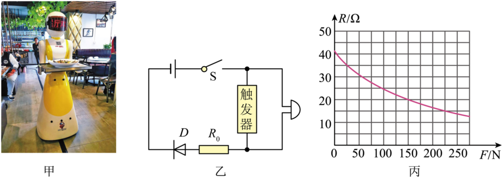

# Physics - 题目 1767

**ID**: f3e8f564af384123af1b1118dd1a963d
**年级**: Grade 9
**难度**: Medium-Hard
**题型**: Science Reading

## 题目
阅读下列短文，回答后面的问题智能机器人随着科技的发展进步，智能机器人已被广泛应用于各个领域，图甲所示是目前餐饮行业中广泛使用的送餐智能机器人。​​​​​​​‌智能机器人也有“大脑”，负责即时处理通过传感器接收到的各种信息，可以像人类一样具有视觉、听觉、触觉、嗅觉，能用自然语言和人类对话。智能机器人行进时，不断向外发射超声波、接收反射回来的超声波，通过计算反射和接收超声波的时间间隔来确定障碍物的位置；精密电动机为机器人提供动力，驱动底座的轮子而使其整体平稳运动，并使其手、脚、触角等协调配合，完成比较复杂的动作，代替甚至超越餐厅服务员的工作。智能机器人使用的电源主要有钠硫电池、镍镉电池、锂电池等。通常情况下， 当电池电量减为其容量的10%时，智能机器人就会自动寻找充电座充电，并将其电池剩余电量的40%用于克服阻力做功，为确保该智能机器人能顺利返回充电，离充电座的最远路程不能超过500m。下表是智能机器人所用电池和电动机的部分参数。锂电池电压24V容量10A·h电动机额定电压24V额定功率120W线圈电阻0.5Ω送餐的智能机器人还具有过载自动保护系统，其电路原理如图乙所示，此电路电源的电压为 16V， 图中D为餐盘下面的压敏二极管，其阻值R 随所受压力变化的图像如图丙所示，图乙中的触发器为电路保护开关，机器人手能承受的最大压力是150N，当电路中的电流大于 0.5A 时，触发器断开，电铃会发声提示，以免机器人损伤。（1） 智能机器人通过嗅觉传感器能“闻”到外界的各种气味，是因为气体分子。（2） 机器人向前方距离为3.4m的障碍物发射超声波，则经过s 后能够收到障碍物的回波。该机器人工作时通过电动机的电流为A．（超声波速度取 340m/s）（3） 乙图中保护电阻 R_{0}的阻值是Ω。（4） 电池两次充电间隔内，机器人连续工作，期间电动机线圈产生的电热是J。该智能机器人匀速行驶时受到的水平阻力为N。

## 解答

1. （1）智能机器人通过嗅觉能闻到外界的各种气味，说明分子在做无规则的运动，外界分子运动到各处。
2. （2）由式子 $v=\frac {s}{t}$ 可得，机器人向前方距离为3.4m的障碍物发射超声波，能够收到障碍物的回波的时间为 $t=\frac {2s}{t}=\frac {2\times 3.4{\rm{m}}}{340{\rm{m}}/{\rm{s}}}=0.02{\rm{s}}$ ，由电功率公式P＝UI可知，该机器人工作时通过电动机的电流 $I=\frac {P}{U}=\frac {120{\rm{W}}}{24{\rm{V}}}=5{\rm{A}}$ 。
3. （3）由图乙可知，闭合开关，电阻R_{0}与压敏二极管串联接入电路，机器人手受到的压力达到150N时，电路中的电流为0.5A，触发电动机停止工作，由图丙可知，此时压力传感器的阻值R＝20Ω由 $I=\frac {U}{R}$ 可知，此时电路中的总电阻 $R{{}_{总}}=\frac {U}{I}=\frac {16{\rm{V}}}{0.5{\rm{A}}}=32{\rm{Ω}}$ ，触发器为电路保护开关，其电阻忽略不计，根据串联电路的电阻特点可知，电阻R_{0}的阻值R_{0}＝R_{总}-R＝32Ω-20Ω＝12Ω。
4. （4）由表中数据可知，额定电压为24V，电池容量为10A·h，充满电后所有电能W_{总}＝U′I′t＝24V×10A·h＝240W·h＝0.24kW·h，因为锂电池的电流减为其容量的10%时，机器人服务员就会自动寻找充电桩充电，则在这过程中，电动机连续工作消耗的电能W_{1}=（1-10%）W_{总}＝90%×0.24kW·h＝0.216kW·h，则锂电池剩余电量W_{剩}＝W_{总}-W_{1}＝0.24kW·h-0.216kW·h＝0.024kW·h，机器人搜寻到达充电桩的过程还需消耗锂电池剩余电量的40%，所以机器人在这段过程中需要消耗的电能W_{2}＝40%W_{剩}＝40%×0.024kW·h＝0.0096kW·h，电动机的额定功率P_{额}＝120W＝0.12kW，由 $P=\frac {W}{t}$ 可知，电动机连续工作的时间 $t{{}_{1}}=\frac {W{{}_{1}}}{P{{}_{额}}}=\frac {0.216{\rm kW}·{\rm{h}}}{0.12{\rm kW}}=1.8{\rm{h}}$ ，
5. 机器人搜寻并到达充电桩的过程所用的时间 $t{{}_{2}}=\frac {W{{}_{2}}}{P{{}_{额}}}=\frac {0.0096{\rm kW}·{\rm{h}}}{0.12{\rm kW}}=0.08{\rm{h}}$ ，电动机连续工作的总时间t_{总}＝t_{1}+t_{2}＝1.8h+0.08h＝1.88h＝6768s，锂电池充满电后，电动机连续工作至下次开始充电的过程中，电动机线圈产生的电热Q＝I″^{2}R_{M}t_{总}＝（5A）^{2}×0.5Ω×6768s＝8.46×10^{4}J
6. 由题意可知，该智能机器人匀速行驶时受到的水平阻力为 $f=\frac {W{{}_{2}}}{s}=\frac {0.0096{\rm kW}·{\rm{h}}}{500{\rm{m}}}=\frac {3.456\times 10{^{4}}{\rm{J}}}{500{\rm{m}}}=69.12{\rm{N}}$ 。

## 知识点

**中文**:
  - 分子热运动
  - 速度公式及其应用
  - 功的计算和估算
  - 欧姆定律的应用
  - 电路的动态分析
  - 电功与电能的计算
  - 电功率的计算及应用
  - 焦耳定律的计算公式及其应用

**English**:
  - Thermal Motion
  - Velocity Formula and Applications
  - Calculation and Estimation of Work
  - Applications of Ohm's Law
  - Dynamic Circuit Analysis
  - Calculation of Electric Work and Energy
  - Calculation and Application of Electric Power
  - Formula and Application of Joule's Law

---
